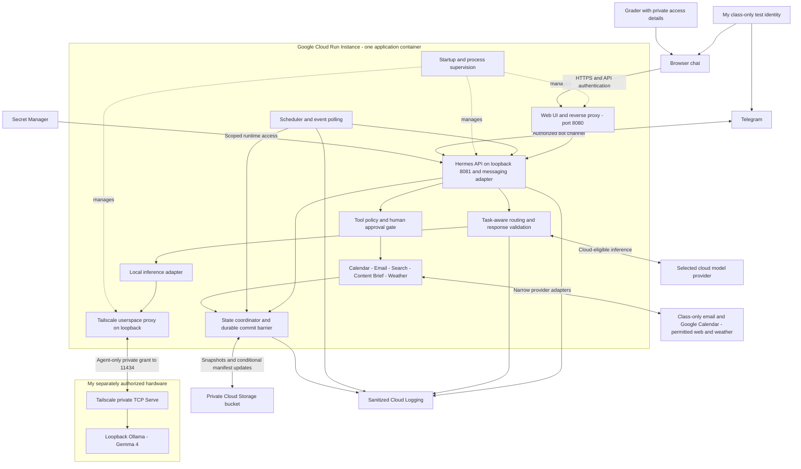
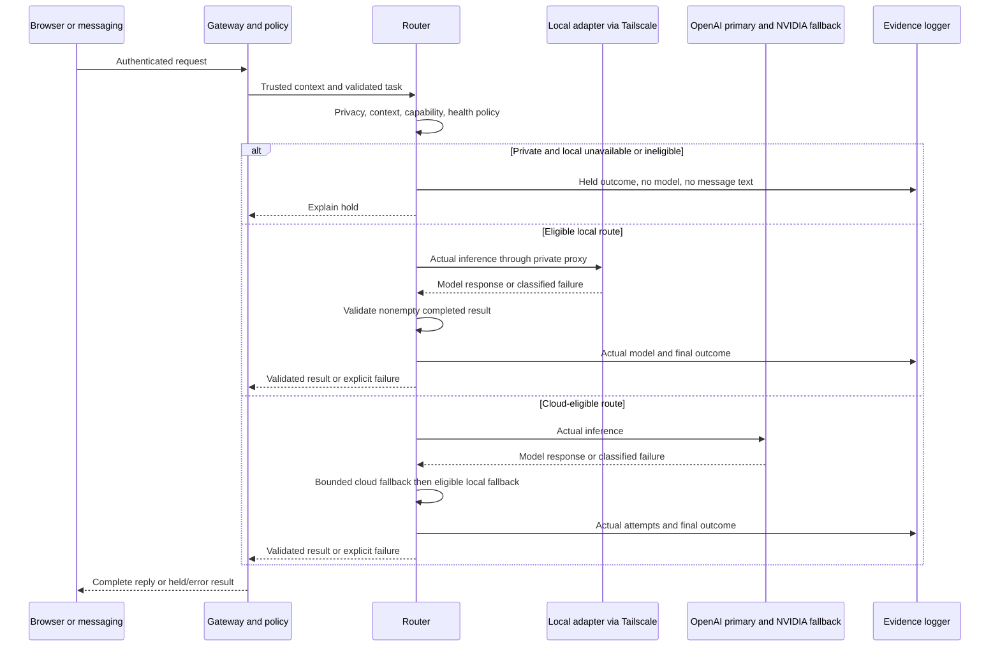
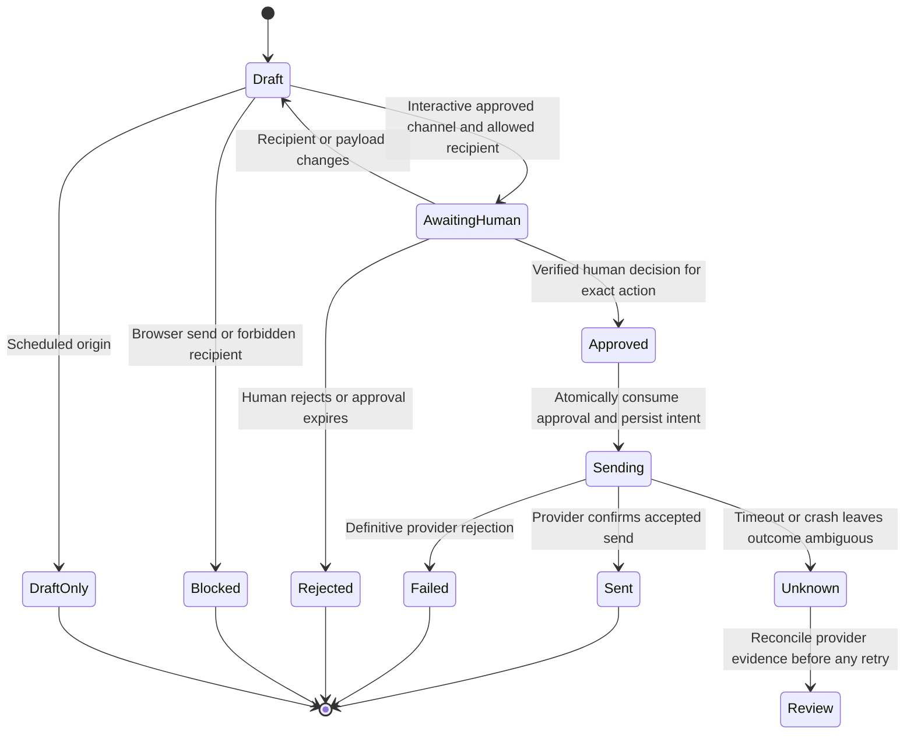
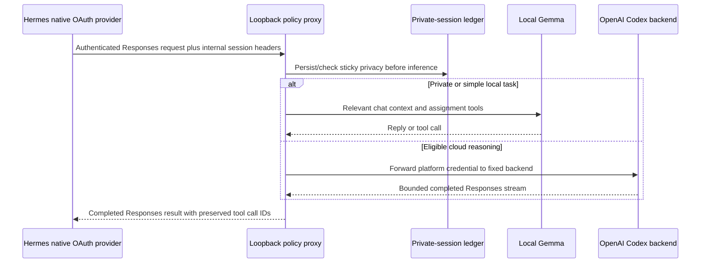

# Monday — System Architecture

I use this design to explain each component, its purpose and its failure boundaries. **Five diagrams and section A15 map all 94 requirement IDs.** Architecture coverage describes my intended contract; [implementation status](IMPLEMENTATION_STATUS.md) records what has actually passed.

**Selected stack:** Hermes v0.22.7, Python 3.14, Telegram, Monday browser chat, OpenAI OAuth, local Gemma, NVIDIA fallback, SQLite, GCS and Secret Manager. My hardened image uses SQLite 3.54.1.

## On this page

- [A1. Scope, assumptions, and decision status](#a1-scope-assumptions-and-decision-status)
- [A2. Technology choices and their justification](#a2-technology-choices-and-their-justification)
- [A3. Whole-system topology and responsibility boundaries](#a3-whole-system-topology-and-responsibility-boundaries)
- [A4. Entry points, UI, and interface contracts](#a4-entry-points-ui-and-interface-contracts)
- [A5. Hybrid routing, privacy, and model failure](#a5-hybrid-routing-privacy-and-model-failure)
- [A6. Tool execution, email approval, and the fourth skill](#a6-tool-execution-email-approval-and-the-fourth-skill)
- [A7. Proactive scheduling and delivery](#a7-proactive-scheduling-and-delivery)
- [A8. Persistence, concurrency, and restoration](#a8-persistence-concurrency-and-restoration)
- [A9. Security architecture and release gates](#a9-security-architecture-and-release-gates)
- [A10. Runtime lifecycle, availability, and the observation window](#a10-runtime-lifecycle-availability-and-the-observation-window)
- [A11. Isolated development and GitHub delivery](#a11-isolated-development-and-github-delivery)
- [A12. Evidence architecture, reports, and submission](#a12-evidence-architecture-reports-and-submission)
- [A13. Conditional branches and alternatives](#a13-conditional-branches-and-alternatives)
- [A14. Validation strategy and unresolved implementation gates](#a14-validation-strategy-and-unresolved-implementation-gates)
- [A15. Requirement-by-requirement architecture coverage](#a15-requirement-by-requirement-architecture-coverage)
- [A16. References and document review](#a16-references-and-document-review)
- [A17. Appendix — technology and development-stack overview](#a17-appendix--technology-and-development-stack-overview)
- [A18. Repository follow-up and coverage review](#a18-repository-follow-up-and-coverage-review)
- [A19. Implementation plan after the extracted-script review](#a19-implementation-plan-after-the-extracted-script-review)
- [A20. My implemented OAuth boundary](#a20-my-implemented-oauth-boundary)
- [A21. My verified setup boundary and release authorization](#a21-my-verified-setup-boundary-and-release-authorization)
- [A22. My separate native cloud-authentication checkpoint](#a22-my-separate-native-cloud-authentication-checkpoint)

## A1. Scope, assumptions, and decision status

My selected baseline is one Hermes-based assistant on a Google Cloud Run **Instance**, with Telegram and the supplied browser-chat pattern, cloud inference, and local Gemma 4 served by Ollama through Tailscale.

- A small set of custom adapters would implement task-aware routing, controlled tools, durable state, scheduling, and evidence collection around the selected platform.
- I do not need multiple collaborating agents or a second orchestration framework for this design.

The assignment has three separate capability obligations:

| Obligation | My proposed response | What remains open |
| --- | --- | --- |
| Four working skills | Calendar, email, web search, and LinkedIn Content Brief. Weather is also needed for briefings. | Tool providers, scopes, exact framework integration, and my approval. |
| Four of six advanced features | Morning briefing, end-of-day recap, email integration, and proactive alerts. | Final selection; briefing, recap, and alert must appear in the demo regardless. |
| One advanced integration | Publish my original content skill through an allowed Hermes skill tap, with a pinned version and fresh-install/run evidence. | My selection and separate authorization to publish. A2A and three messaging platforms remain alternatives in A13. |

The publication recommendation reuses the fourth skill while avoiding a dependency on another person's availability or two additional messaging services.

- This is my design inference, not extra credit or automatic fulfillment of ADV-01.
- I would publish only the approved standalone skill package, not the full assignment repository, credentials, or synthetic account configuration.
- The assignment's permitted publication option and individual-work rules both remain applicable. [D pp. 17, 20; S pp. 9-10]

All accounts and personalization remain synthetic.

- I have authorized full implementation in approved Docker, local Gemma checks, bounded synthetic tests and routine reviewed Git pushes. Provisioning, paid calls, deployment and publication still need their stated inputs/approval.
- The deadline is November 17, 2026, 11:59 PM; America/Los_Angeles is the planning timezone and grace balance is unknown. Q07 describes grader tests after End Date (deadline + 2) and again 48 hours later. [USER-01/02/08/12; POLICY-01; CLARIFICATIONS.md Q07]

## A2. Technology choices and their justification

I distinguish assignment-mandated technologies from recommendations. Every selected release, dependency, tool, and model will need a pinned version and compatibility evidence before implementation. Official references below substantiate capabilities; they do not certify this proposed combination.

| Component or technology | Why I would use it | Tradeoff and decision gate |
| --- | --- | --- |
| Hermes platform, proposed | It is an allowed framework and the assignment supplies a browser proxy, startup examples, and approval-hook guidance. Reusing those contracts keeps custom work focused on routing, safety, and the fourth skill. | Exact release hooks, runtime compatibility, scheduler behavior, and background writers need inspection. OpenClaw remains the alternative in A13. [G pp. 1-16; Z Hermes files] |
| Python extensions for Hermes | My router, policy adapters, state coordinator and tests share the platform runtime. | Python 3.14.10 and Hermes v0.22.7 are pinned and locally exercised. Cloud compatibility still needs deployed evidence. [REQUIREMENTS.md section 11] |
| Small HTML/CSS/JavaScript browser interface | It can preserve the supplied web UI/API contract while implementing accessible neumorphic chat and draft cards. A second frontend server/build framework is unnecessary for the current screen. | Supplied scripts and response formats need review. Safe text rendering, authentication, keyboard use, and mobile behavior need browser tests. [HERMES-01/04; USER-11] |
| Telegram, proposed | It meets the required messaging channel and gives me a place for scheduled delivery and supported human approvals. | One polling consumer per bot, authorized numeric identities, and callback validation are necessary. Discord is a valid substitute. Telegram documents an HTTP Bot API; buttons alone are not an authorization policy. [Telegram Bot API](https://core.telegram.org/bots/api) |
| Google Cloud Run Instance | It is the required long-running host for the gateway and scheduler. | I need a supported region, quotas, resource allocation, stable URL, and actual Instance configuration. The documented command family is `gcloud beta run instances`; a Service-only workflow would be wrong. [Instance lifecycle](https://docs.cloud.google.com/run/docs/instances/create-and-manage-instances) |
| Docker-compatible image and isolated development VM/container | One reproducible image packages the runtime and gives me a reviewed execution boundary. A separate disposable development environment satisfies my sandbox rule. | Containers still need restricted mounts, identities, capabilities, network access, and resource limits. A virtual environment only manages packages. No local Docker startup or host installation is authorized. [Docker execution controls](https://docs.docker.com/engine/containers/run/) |
| Gemma 4 through Ollama on my hardware | This is the required local inference route. E2B is a reasonable first candidate to evaluate against available RAM, without changing the assignment's accepted model choices. | Tag, quantization, context, thinking/output budget, and full-turn performance remain unmeasured. Larger context needs more memory; actual served context/offload can be inspected with `ollama ps`. [Ollama context](https://docs.ollama.com/context-length) |
| Hermes OpenAI browser OAuth primary; NVIDIA NIM fallback | OpenAI is my working primary choice under Q02 and my provider instruction; NVIDIA remains a secondary cloud path. Claude API is an allowed primary alternative. | OpenAI gpt-6.1-sol OAuth is verified; direct NVIDIA preflight passed; deployed fallback acceptance remains pending. Both OAuth routing and the optional paid adapter now have isolated coverage. Edu OAuth is a distinct supported entitlement, not an API key. NIM reliability remains a fallback risk. [CORE-03; CLARIFICATIONS.md Q02/Q09] |
| Tailscale userspace proxy and private Serve path | This supplies the required cloud-to-laptop link without publicly exposing Ollama. Userspace networking offers SOCKS5/HTTP proxy access where a TUN device is unavailable. | The local inference client must explicitly use the proxy; having an online Tailscale node is insufficient. Generic ephemeral-node advice does not override G's OpenClaw persistence rules. [Tailscale userspace networking](https://tailscale.com/docs/concepts/userspace-networking) |
| Dedicated Cloud Storage bucket | It is the required durable home for workspace/memory, snapshots, and retained evidence under separate access/retention policies. | Object storage is not a transactional shared filesystem. Active lock-dependent state stays on container disk, with the consistency protocol in A8. [Cloud Storage FUSE limitations](https://docs.cloud.google.com/storage/docs/cloud-storage-fuse/overview) |
| Platform-native state plus my SQLite journal | Existing workspace files retain platform compatibility; a coordinator records job, approval, content, and durability state. My local SQLite journal records these transitions. | SQLite is selected and implemented; the hardened image uses version 3.54.1. Any SQLite use stays off FUSE and needs consistent backup, migrations, integrity checks, and restore tests. Otherwise I need an equivalent transactional local journal. [OPS-01/02/03; S pp. 8-9, 16-19] |
| Secret Manager with runtime identity | Secret-specific access separates credentials from source/builds and supports controlled rotation. | Prefer supported direct retrieval; if the assignment's platform requires injected variables/files, restrict access and prevent environment/file disclosure. Mutable OAuth state needs a separately reviewed persistence path. [Secret Manager guidance](https://docs.cloud.google.com/secret-manager/docs/best-practices) |
| Cloud Logging plus durable sanitized exports | Routing, lifecycle, and job evidence can be correlated without recording message text. Exports preserve the actual observation interval for submission. | Retention, export permissions, sensitive fields, and gaps need review before the window starts. Logs alone do not prove successful external delivery. [CORE-10; OPS-06/07/08] |
| GitHub Actions, Artifact Registry, and GCP OIDC | Isolated checks and immutable image promotion support repeatable releases; OIDC avoids storing a long-lived GCP key in GitHub. | Repository plan/access, restricted trust claims, separate identities, release approval, and freeze enforcement need implementation. [GitHub OIDC for GCP](https://docs.github.com/en/actions/how-tos/secure-your-work/security-harden-deployments/oidc-in-google-cloud-platform) |
| Platform scheduler/cron and bounded event polling | It supports proactive work without adding another scheduling service. | Jobs need timezone, deduplication, catch-up policy, completion/delivery records, and a single active scheduler. A continuous `sleep()` loop is not my trigger mechanism. [FUNC-04; OPS-03] |
| My calendar, email, direct search and weather adapters | Own Google OAuth/scopes, dedicated accounts, Tavily key and bounded custom workflows provide meaningful integration and testable safety boundaries. | Google refresh and calendar access are verified; remaining integration demonstrations are pending. Enabling bundled capabilities or merely wrapping bundled search does not qualify. [FUNC-02/06/07/08/09; Q05] |

I would omit Kubernetes, Redis, a vector database, a second agent framework, and a separate UI hosting service from the initial build because no current requirement needs their operational overhead. This is a scope decision, not a claim that those tools are generally unsuitable. If a measured limitation requires one, I will document its benefit, cost, and new failure modes before adding it.

My version manifest will record the framework release and observed runtime version, Python or Node version, dependency lock, base/image digest, Google CLI, Tailscale, Ollama, Gemma tag/digest, cloud model IDs, skill commit, and schema/config revision. G's tested versions are source examples, not an instruction to use a moving `latest`.

- The official [Hermes repository](https://github.com/NousResearch/hermes-agent) is the upstream reference for the eventual pinned release; it does not replace the assignment's access contract.

## A3. Whole-system topology and responsibility boundaries

Figure 1 shows the proposed Hermes path. Boxes inside the container are responsibilities or supervised processes, not separate microservices. The public web edge and model providers are different trust boundaries; a model can propose a tool call but cannot bypass the policy layer.



Figure 1 implements CORE-01 through CORE-05, FUNC-01/02, OPS-01 through OPS-04, and the Hermes branch. Cloud and tool connections can carry synthetic content; that does not make external services trusted instruction sources. The diagram's secret arrow is abbreviated: only components requiring a given credential may receive it, and the UI never receives cloud, email, or Tailscale secrets.

| Logical component | Responsibility and boundary | Why the separation matters |
| --- | --- | --- |
| Gateway/session adapter | Authenticate entry, normalize trusted channel identity, maintain session ownership, assign request IDs, and dispatch agent turns. | Model-generated text cannot choose an identity or upgrade a browser session into an approval-capable channel. |
| Router/model adapters | Classify task properties, apply privacy/context/availability policy, invoke the actual provider, validate results, and emit outcome records. | Routing decisions remain testable independently from model prose and tool execution. |
| Tool policy | Validate tool name/arguments, session permissions, recipient allowlist, and exact human approval before dispatch. | One enforcement boundary covers aliases and alternate entry points; prompts alone cannot authorize side effects. |
| Skill/provider adapters | Fetch bounded data or perform explicitly authorized actions, returning normalized results and provenance. | Provider failures and authentication do not leak into every feature implementation. |
| Scheduler | Produce typed noninteractive job requests with deduplication and delivery destination. | Background work cannot inherit interactive approval or hang waiting for a person. |
| State coordinator | Serialize mutations, enforce durable acknowledgements, manage snapshots and recovery. | Background memory jobs, chat, and scheduled work cannot race by writing shared files independently. |
| Supervisor/evidence layer | Restore state, start processes, evaluate readiness, supervise shutdown, and record lifecycle. | A running web process cannot conceal a dead gateway, lost state, or failed scheduler. |

## A4. Entry points, UI, and interface contracts

For Hermes, the supplied `web_ui.py` pattern listens on external `$PORT` (default 8080), forwarding `/v1/*` and `/health` to the loopback API at `127.0.0.1:$HERMES_PORT` (default 8081).

- The image includes the UI, and startup supervises both UI and gateway.
- If Tailscale Serve is used for this branch, it points at the UI.
- I would preserve those contracts while adding DESIGN.md's raised panels, recessed composer, readable contrast, keyboard focus, responsive layout, and honest loading/error states. [HERMES-01/02; G pp. 3-13; Z Hermes files]

The supplied proxy currently forwards non-root GET and POST/PUT/DELETE/OPTIONS beyond the minimum documented API paths. My adaptation needs a compatible route/method policy and backend-authentication tests; static-page access is distinct from API authorization. Source-level resource limits and safe structured access logs need work (VULN-001/002). Exact source locations are in [SCRIPT_REVIEW.md](SCRIPT_REVIEW.md).

The browser authenticates with a securely injected `API_SERVER_KEY` of at least 16 characters.

- I will verify missing/wrong-key denial, keep credentials out of URLs/assets/logs, and privately supply grader access through Brightspace.
- A login view is not proof of server-side enforcement. Browser sessions cannot invoke approval-gated sends: they receive a prompt block with draft/messaging alternatives. Copying a content draft is not publishing it. [HERMES-03/04]

I would use the selected platform's Telegram adapter with one long-polling consumer per token, authorized numeric identities, and separate test credentials for any staging consumer. Requests and callbacks carry a trusted channel/session identity; display names and model arguments are not identity evidence. Scheduled outputs go only to an explicitly configured class-only destination. Telegram API support and the platform's approval hook must both be verified. [FUNC-01; S pp. 6-7; G pp. 14-16]

The starter payload contains full in-memory browser history and a gateway model label, with no explicit session identifier. I must verify trusted API-session identity rather than assume an API key/history provides isolation. The approval example's undefined policy/platform map and unknown-platform fallthrough need a registered hook with trusted provenance and deny-by-default handling.

The following are proposed internal contracts, not invented public endpoints or claims about existing framework method names:

| Contract | Minimum fields and invariants |
| --- | --- |
| Request context | Request ID, trusted identity/session/channel, interactive or scheduled origin, timestamp, deadline, and privacy classification. Content is available only where needed and excluded from routing logs. |
| Route decision | Route, reason code, policy revision, context estimate, dependency state, and configured candidate model. The completed call records the actual responding model separately. |
| Tool request/result | Validated operation and typed arguments, scope, provenance, bounded result size, success/error classification, and action ID for side effects. |
| Approval record | Action ID, principal, session, exact normalized recipients/content/attachments hash, expiry, decision, and single-use status. Records never embed credentials. |
| Job run | Job ID/revision, scheduled slot, timezone, trigger ID, run ID, deduplication key, completion state, and destination/delivery receipt. |
| Durable mutation | Operation ID, expected state revision, owner, mutation type, commit outcome, and resulting snapshot/manifest generation. |

These boundaries let white-box tests exercise policies and black-box tests assert behavior through the real interfaces without relying on model wording.

## A5. Hybrid routing, privacy, and model failure

**Provider migration plan:** My cloud adapter will try the chosen OpenAI model, then the configured NVIDIA model only on eligible transient/rate-limit failures within a shared deadline/attempt budget. Authentication/configuration errors surface clearly; no request can cycle indefinitely between providers. Private/local-only context never enters either cloud provider. Logs distinguish selection, each attempted provider/model, fallback reason and final outcome without message bodies or credentials. Claude is an accepted alternative, not an automatically enabled third paid provider.

My reversible 429 controls must support both primary-failure → NVIDIA verification and whole-cloud-chain rate limiting → local Gemma demonstration. Mock tests must verify both, plus private hold and exhausted fallback. My OAuth proxy and optional API adapter have isolated migration tests; my selected models are recorded and real direct calls passed; deployed failure-path checks remain pending. [Q02/Q09/Q12]


My proposed private-task policy is **hold** when an eligible local call cannot complete; cloud fallback for private content is not enabled. Privacy classification must occur before any cloud classifier or logging of content.

- I would use explicit trusted privacy flags plus conservative local rules for supported requests, with ambiguity defaulting to hold or clarification. Privacy promises cover the full turn, including tool results and history; a local-only label does not authorize sending its content to an external search/email provider.

My routing precedence would be:

| Priority | Condition | Planned outcome |
| --- | --- | --- |
| 1 | Invalid identity, oversized input, forbidden operation, or exhausted request budget | Reject before model/tool work with a sanitized result. |
| 2 | Private/local-only request | Use local only if available and the entire turn fits its verified limits; otherwise hold without cloud inference. |
| 3 | Non-private request exceeding local context/capability, or needing deeper reasoning | Use the configured cloud route if available. |
| 4 | Non-private simple/extractive task within local capability | Prefer local when healthy; use cloud if local is unavailable. |
| 5 | Primary cloud rate limit or reversible simulation | Try the configured NVIDIA fallback within the bounded cloud policy. If the complete cloud chain fails/is deliberately rate-limited, use eligible local inference or return a truthful error. Private turns never enter this chain. |
| 6 | Other provider/network failure | Apply bounded retry only where safe, then a permitted fallback or explicit failure. No infinite route oscillation. |

Rules operate on task properties, not equality checks for the video prompts. Equivalent arithmetic, explanatory, and private test cases must exercise the same rules.

- If tool output expands a turn beyond the local budget, I will re-evaluate eligibility before the next model call; private turns cannot silently migrate to cloud.
- A long prompt must not be truncated without disclosure to manufacture a pass. [CORE-06/07/08/09/11]



Figure 2 separates selection from completion. After an initial local failure, only a non-private eligible turn may use cloud fallback. Every model attempt and final request outcome need correlation; a configured route, HTTP 200, partial stream, or empty response is not successful inference. Tool-use cycles return through the policy layer in Figure 1. [CORE-10]

The local adapter alone uses a loopback SOCKS/HTTP proxy to the fixed authorized tailnet endpoint. Ollama binds to loopback on my hardware, exposed only through a private Tailscale TCP path and agent-only grant. General web fetching cannot reuse this private-network privilege. Health checks distinguish transport reachability, installed model, and successful inference. `/api/tags` lists models; it is not proof of a completed agent turn. [Ollama model listing](https://docs.ollama.com/api/tags)

My health design distinguishes ready, unavailable and recovering, with bounded probes/cooldown. Laptop shutdown does not trigger endless network repair.

- Hermes retains at least 64K context; my machine served 65,536 and completed a real tool turn. Q01 permits task-relevant context/tools while retaining necessary policy/history. Q03 requires a reproducible local reply for local points; cloud-only operation forfeits those points.
- A friend's machine is allowed for the video with truthful attribution, not a claim that my deployment used it.

The reversible 429 test is a trusted test configuration scoped to the cloud adapter, never triggered by arbitrary chat text.

- It records simulated status, demonstrates eligible local fallback, and is removed and verified before ordinary operation. Actual quota exhaustion is unnecessary.
- The video uses the four exact prompts and local off/on sequence already preserved in REQUIREMENTS.md; the expected route pattern under my proposed policy is local → cloud → held → local.

## A6. Tool execution, email approval, and the fourth skill

Q05 requires substantive integration and README evidence for each of calendar, email, web search and my original content skill.

- My direct Tavily adapter uses my own credentials; it does not merely wrap bundled search.
- Google tools use my own OAuth client/scopes and dedicated synthetic accounts. Q01 allows two fictional-role mailboxes and requires explicit approval for every send.
- The original content workflow combines sourced research, synthesis, deduplication and review history without publishing. Live use and demonstration remain required; code existence alone is not completion.


| Adapter/skill | Input and useful output | Control and reason |
| --- | --- | --- |
| Calendar | Dedicated Google Calendar events with timezone and bounded date range; normalized events and gaps. | Synthetic calendar only; read access first.

- Any future writes require an explicit action policy. Provides the calendar skill and briefing/alert context. | | Email | Bounded unread/flagged messages, summaries, urgency candidates, and draft replies. | Provider/auth/capabilities documented separately.
- All send paths use the same code gate and recipient allowlist. Provides useful assistance without unattended sending. | | Web search | Approved topic query; dated links and bounded source extracts with provenance. | Validated destinations, limits, source policy, and untrusted-content handling.
- This remains its own exercised skill. | | Weather | Configured synthetic location; timestamped forecast/conditions. | Vendor remains open. Failed weather retrieval is labeled unavailable rather than fabricated, and the final briefing acceptance requires working weather. | | LinkedIn Content Brief | Synthetic audience/topics/tone plus permitted research; one original daily draft, source notes, and review history. | Draft-only capability, no LinkedIn account or Publish operation. Adds synthesis, topic selection, deduplication, and scheduling beyond web search. |

Email authorization binds a human decision to exact normalized recipients, subject/body and any attachments, the requesting identity, and an expiry. Changing the payload invalidates approval.

- I will check all recipients, including CC/BCC where supported, and reject unsupported recipient forms instead of guessing.
- A browser/API session, scheduled job, model/guardian, broad shell tool, mail CLI, or alternate adapter must not bypass this boundary.
- Only the restricted send adapter holds usable send authority; raw shell/interpreter execution with those credentials is outside the permitted tool catalog. [FUNC-07; SEC-03; HERMES-04; S pp. 15-16]



Figure 3 is my proposed email action lifecycle.

- A consumed approval cannot be replayed.
- I cannot promise exactly-once email delivery if the provider offers no idempotency support: a timeout after dispatch may mean the send occurred.
- The durable intent and Unknown state prevent blind resend; reconciliation and any renewed approval follow the reviewed action policy.
- The UI must not show Sent until evidence supports that state.

For Google APIs, the eventual implementation must enable the needed APIs, configure dedicated-account consent, choose narrow scopes, verify draft permissions separately, and exercise refresh during the observation run.

- My authorization review also needs to assess any provider verification requirements for the selected scopes and app status. Scopes are not a substitute for the send gate.
- A non-Gmail dedicated email provider remains valid, but Google Calendar is still required. Provider choice, authentication, account access for graders, and refresh lifetime are release gates rather than implicit assumptions. [FUNC-06/09; ACCESS-01/02/03]

The content skill pipeline is research → date/relevance checks → topic/history comparison → original draft → claim/source review → durable draft → review-channel notification. Its output includes a draft ID, topic, draft text, source references/dates, uncertainty notes, and review status. Copy, Revise, and Dismiss stay within the chat UI. There is no success metric claiming increased reach and no invented first-person achievements. Missing or conflicting evidence produces an explanation or a qualified draft, never a fabricated trend.

Direct LinkedIn keyword search, scraping, personal-account access, likes/comments/messages, and automatic posting are excluded from this proposal. LinkedIn prohibits unauthorized website scraping/automation; its documented Posts API is permission-scoped and does not establish unrestricted search access.

- A later official API integration would require a verified supported use case and separate approval. [LinkedIn policy](https://www.linkedin.com/help/linkedin/answer/a1341387/prohibited-software-and-extensions), [Posts API](https://learn.microsoft.com/en-us/linkedin/marketing/community-management/shares/posts-api)

My proposed ADV-01 extension packages the original skill contract, implementation, dependencies, synthetic examples, attribution, and tests in an approved registry/tap format. Evidence needs a public pinned version and clean-environment installation/execution transcript; directly loading a `SKILL.md` URL is insufficient. That package does not include service secrets or assignment account data. [ADV-01]

## A7. Proactive scheduling and delivery

My scheduler runs in the cloud Instance and uses the platform's supported cron/heartbeat/event mechanisms. Each registered job has a stable ID and revision, explicit timezone, destination, timeout, retry budget, and noninteractive permissions. Registration is idempotent at startup. The single active scheduler must share the same state discipline as interactive requests.

| Job | Trigger and result | Grounding and failure policy |
| --- | --- | --- |
| Morning briefing | Configured local morning; calendar events/gaps, weather, and one-line unread/flagged-email summaries. | Source timestamps and partial failures are visible. A complete acceptance run needs all required integrations. |
| End-of-day recap | Configured local evening; actual completed tasks/messages, pending decisions, and tomorrow's early meetings/deadlines. | Reads activity outcomes, not model-invented accomplishments. |
| Proactive meeting alert | Scheduled calendar polling detects a fresh synthetic meeting entering the reminder window. | Event ID, revision and reminder slot prevent duplicates; startup baselining, changed/cancelled meetings and quiet hours are explicit policies. |
| Email urgency review | Approved periodic polling or supported event trigger. | Summarizes/flags test email; drafts and notifies without sending or waiting for approval. |
| Daily content draft | Configured daily slot; one research-backed draft for review. | Deduplication across topic history and daily job ID; bounded source/model attempts; no publishing. |
| Health/evidence/state maintenance | Configured bounded checks and snapshots. | Records real health, backlog, backup and recovery outcomes; does not generate fake conversation traffic as proof of availability. |

A run key includes job ID/revision, intended local date/slot with timezone, and relevant trigger version.

- I will specify daylight-saving and missed-run behavior before implementation: a repeated clock hour must not duplicate a daily draft, and a restart must not silently emit a backlog of obsolete alerts. Expired alerts are recorded as missed/suppressed; a valid catch-up is labeled as such. Quiet-hour deferrals remain visible.

My durable job/outbox record distinguishes queued, running, completed, delivery pending, delivered, failed, and uncertain outcomes. Delivery receipt IDs are recorded where supported. Retries are bounded; external notification delivery can be uncertain after a timeout, so I will document provider-specific duplicate reconciliation rather than claim universal exactly-once delivery. Run-now invokes the same registered job and records its manual trigger.

- It is allowed for the video briefing/recap but does not replace autonomous execution during operation. [FUNC-03/04/05; VIDEO-06]

## A8. Persistence, concurrency, and restoration

The authoritative durable state lives in a dedicated private Cloud Storage bucket. Active platform databases, lock-dependent files, and journals use private container-local storage, restored before work starts.

- Cloud Storage FUSE is not POSIX compliant; I will not treat a mounted bucket or local process lock as a distributed transaction. [Cloud Storage FUSE](https://docs.cloud.google.com/storage/docs/cloud-storage-fuse/overview)

| State class | Proposed contents and handling |
| --- | --- |
| Platform workspace | OpenClaw `SOUL.md`, `USER.md`, and `IDENTITY.md`, or the selected Hermes release's corresponding synthetic personality/context/memory files at the actual configured platform paths. Preserve native file formats; do not create an unused parallel memory directory. |
| Operational journal | Request/action IDs, approvals, jobs, content draft history, activity outcomes, schema revision, and outbox state. Private snapshots are not submission evidence. |
| Credentials/auth state | Secret Manager for static keys; reviewed restricted persistence for refreshable tokens and Tailscale identity. Exclude from ordinary workspace exports and build contexts. |
| Snapshot generations | Immutable complete snapshots with manifest, checksums, schema/platform versions, sequence and timestamp. No raw copy of a live SQLite database. |
| Evidence exports | Sanitized lifecycle/routing/job/backup records with true time bounds and artifact revision. Separate from secret-bearing backups. |

My proposed consistency protocol is deliberately conservative for a small assignment workload:

1. Restore the last committed manifest and verify its referenced snapshot before enabling writes or jobs. Initial empty state requires an explicit bootstrap condition, not a silent fallback after corruption.
2. Admit mutations through one coordinator. Chat, scheduled handlers, memory flush/review/dreaming, credential writers, and other platform background writers need an inventory. Each writer must use a supported serialization/consistent-backup hook or be safely disabled/reconfigured. I will not assume all platform writers obey a new wrapper.
3. Apply a mutation locally with an operation ID and expected revision. Pause relevant writers for a consistent checkpoint; use a supported database backup mechanism if SQLite is involved. If the platform cannot provide this boundary, storage design must be revised before release.
4. Upload a complete immutable snapshot, verify its metadata/checksum, and publish a small commit manifest using a generation-match precondition. Only then acknowledge a durable memory update or authorize a pending external action to dispatch. Persist action outcomes through the same path.
5. If manifest publication fails, do not acknowledge durable success or dispatch new side effects. A generation conflict stops writes and triggers investigation; it must not be resolved with an unconditional overwrite. Failed/unreferenced snapshots are not committed state.
6. On restart, restore only a committed consistent generation, reconcile pending/uncertain external actions, and resume valid jobs. Graceful shutdown drains bounded work and checkpoints, but crash recovery cannot depend on shutdown running.

Google Cloud Storage supports generation-match preconditions that reject a changed object with HTTP 412, including create-only writes using generation zero. I use this primitive for a proposed single-manifest commit, not as a claim of multi-object transactions. [Storage preconditions](https://docs.cloud.google.com/storage/docs/request-preconditions)

```mermaid
sequenceDiagram
    participant W as Chat or scheduled writer
    participant S as State coordinator
    participant D as Local workspace and journal
    participant B as Private Cloud Storage
    W->>S: Mutation with operation ID and expected revision
    S->>D: Serialize update and consistent checkpoint
    D-->>S: Snapshot with sequence and checksums
    S->>B: Upload immutable snapshot
    B-->>S: Snapshot stored
    S->>B: Commit manifest with generation precondition
    alt Commit succeeds
        B-->>S: New manifest generation
        S-->>W: Durable acknowledgement
    else Conflict or storage failure
        B-->>S: Rejected or unavailable
        S-->>W: No durable success; stop unsafe writes/actions
    end
```

Figure 4 describes durable acknowledgement.

- For a turn containing a memory update, my design target is no loss of an acknowledged update after restoration.
- Real GCS durability checks passed; the deployed acknowledgement path and its upload latency still need measurement. Temporary compute and an unacknowledged response may be lost. External sends have their own uncertain-outcome handling in A6; a storage transaction cannot make a third-party send transactional.

The initial operating topology permits only one active gateway/scheduler writer. Deployment must stop/drain the old writer before starting the replacement and must not run staging against the same state or bot token.

- A manifest conflict detects unsafe overlap but is not sufficient distributed leader fencing.
- If the chosen Instance/platform lifecycle permits uncontrolled overlap, I need a verified exclusive-owner/fencing mechanism or a revised topology before release.
- I am not claiming horizontal scalability.

Tailscale daemon identity is a separate writer from application workspace state. The OpenClaw persistent daemon path must retain the actual identity; its before/after source snippet is not two commands to execute together. I will verify supported consistency/restart behavior for daemon-managed state separately rather than assume the application coordinator controls its writes.

My restore tests will cover simultaneous chat/jobs, background writes, failure before and after manifest commit, interrupted snapshots, corrupt/missing snapshots, duplicate action recovery, and a fresh conversation recalling a newly saved synthetic fact after Instance restart. Backups, mount paths, ownership, and permissions become actual deployment evidence. [OPS-01/02/03]

## A9. Security architecture and release gates

The initial threat model covers entry points, untrusted retrieved content, model output, tool authority, persistent state, credentials, network access, build artifacts, and resource exhaustion.

- The eleven prospective risks in SECURITY_REGISTER.md are not discovered vulnerabilities.
- My final audit must identify at least five actual implementation risks, implemented controls and residual risks, with evidence for container isolation plus at least one other security measure. [SEC-01/02/07]

| Boundary | Proposed enforcement | Risk and verification reference |
| --- | --- | --- |
| Browser and messaging identity | Server-side authentication, session scoping, trusted callback identity, and no frontend-only authorization. | RISK-01; wrong/missing credentials and cross-session tests. |
| Human-to-side-effect authority | Payload-bound expiring single-use email approval; recipient allowlist; no content-skill publishing tool. | RISK-03; replay, changed payload, unattended and alternate-tool bypass tests. |
| External data to tools/memory | Treat retrieved email/calendar/web text as data, validate arguments, restrict available operations, and require provenance/validated memory mutations. | RISK-06/11; at least three distinct attacks before claiming injection defense. |
| External URL to network | Allow intended HTTP(S) destinations, validate resolved addresses and redirects, block metadata/private/loopback/file access, cap response/time/redirect sizes. | RISK-04; SSRF and DNS/redirect tests. Only the fixed local-model adapter may use its private endpoint. |
| Model/source text to browser | Escape text, sanitize supported markup/links, prevent executable HTML and unsafe URL schemes, and review browser headers/session storage. | RISK-05; stored/reflected XSS fixtures and safe draft-copy tests. |
| Runtime to secrets and cloud | Minimal runtime identity, secret-specific grants, excluded build paths, redacted errors/logs, and narrow tool credentials. | RISK-02/07; secret scans and synthetic leakage sentinels. Trusted cloud libraries may require metadata-based identity; the general fetch tool must never expose that access. |
| Container to host/private network | Non-root where supported, reviewed effective capabilities/mounts, no privileged mode or Docker socket in application tests, private Ollama, resource limits. | RISK-08/10; effective-isolation report and unauthorized network tests. |
| Writers to persistent state | Coordinator, consistent snapshots, commit barrier, single active writer, session isolation. | RISK-09; conflict/crash/restore tests, not just a successful bucket write. |

The three proposed injection cases target an email asking to bypass send approval, a web source asking to exfiltrate a secret through a URL, and retrieved content attempting to poison persistent instructions. Each needs expected/observed results, safe synthetic payloads, and pass/fail evidence. A refused sentence alone does not prove the forbidden tool or network request was prevented. [SEC-08]

Applicable code, dependency, secret, image and configuration checks run with white-box/black-box tests in the approved sandbox. Scanner selection depends on the eventual runtime and repository plan; no tool is installed or assumed available. Findings receive VULN IDs, exact affected artifacts, severity/rationale, sanitized reproduction, owner, fix and retest evidence. Unresolved Critical/High findings, leaked live secrets, auth/approval bypass, unintended public inference, isolation failures, or incomplete required checks block release.

- Any permitted lower-severity residual risk needs my explicit acceptance with expiry and cannot waive an assignment requirement.

A private “hold” policy concerns model/tool data handling, not an assertion that Telegram or any other transport has no access to its own messages. The assignment uses synthetic data throughout. Grader credentials, real account secrets, private backup contents, and sensitive identity data remain outside ordinary project Markdown, videos, logs, images, and public skill packages. [SEC-04/05; ACCESS-01]

## A10. Runtime lifecycle, availability, and the observation window

I keep the supplied **single Cloud Run Instance** topology; the loopback broker is an internal component, not a second service. Q04's pasted Cloud Run Service IAM/ID-token advice is diagnostic context for a different topology, not a deployment change.

Q07 describes an initial grader check after End Date (deadline + 2) and another 48 hours later. Exact scheduling is not supplied. Q09 requires final-model logs/artifacts and a new video after a primary-model change. Q10 says a minor non-model harness fix does not require repeating the full run; its build/test/outage history stays visible. Q12's fallback-only question is unanswered. None of these waive access through regrades or the no-restart/redeploy grading freeze.


The supplied start-agent.sh is only a two-process supervisor; the following is my planned integrated lifecycle, not behavior already present in that file.

- My startup dependency order is configuration validation → scoped secret/identity access → state restore and owner check → Tailscale setup → platform gateway/scheduler initialization → UI → readiness. Local inference health is tracked separately: an offline laptop must not prevent cloud-eligible chat from becoming available. Startup records the observed platform version, runtime user and effective isolation details without secrets. [CORE-08; SEC-01; HERMES-02]

UI or gateway death causes the supervised unit to exit/recover rather than leaving a misleading half-alive deployment. Shutdown stops new work, drains bounded requests, pauses scheduling, checkpoints state and terminates children. Startup/shutdown logic must preserve the supplied Tailscale and state behavior. Recovery attempts have limits, and errors in state restore are not hidden by creating a fresh empty workspace.

| Condition | My intended behavior and evidence |
| --- | --- |
| Laptop/Ollama unavailable | Cloud-eligible requests continue; private requests hold. Record local health separately from gateway availability. |
| Cloud provider failure | Bounded retries and eligible local fallback; record real failure if neither route is usable. |
| Tool service unavailable | Explain partial/failed feature output and retain retry/review status without inventing data. |
| State durability unavailable | Prevent durable-success claims and new unsafe mutations/actions; allow only explicitly safe behavior with degraded status. |
| Messaging delivery uncertain | Preserve receipt/error and reconcile before retry according to adapter policy. Do not count queued as delivered. |
| Container/platform restart | Restore committed state, preserve identities, reconcile jobs/actions, and record downtime and missed work. |
| Security incident | Record it and seek the required containment/fix authorization; never conceal it to protect an uptime claim. |

My initial allocation would evaluate the source recommendation of 1 vCPU/1 GiB, increasing it if measured runtime/context overhead requires more; the OpenClaw reference suggests 2 GiB.

- These are proposals, not caps or a measured cost estimate. Region, platform support, actual peak memory and build/runtime architecture require validation. Model inference runs on my laptop or the cloud provider, not an assumed GPU in the Instance. [OPS-04/05]

Before grading I complete bounded recovery/load/stress checks and measure memory. Q11 supersedes the older three-hour restart recommendation: planned restarts stay disabled, and unplanned restarts remain incidents with potential penalty.

- I address leaks/concurrency/capacity before the freeze. Q06 explicitly permits 1 vCPU/4 GiB when needed; I justify measured sizing and monitor the approved budget rather than borrow another person's cost estimate. [OPS-07/09/10; CLARIFICATIONS.md]

My observation record includes UTC start/end bounds, scheduler timezone, release digest/config revision, availability samples at a documented cadence, real message/job delivery, routing/model failures, lifecycle events, backup outcomes, and every gap.

- I will choose retention/export storage before starting and export promptly afterward.
- An internal heartbeat alone does not prove external chat access; an approved external probe and real interaction evidence complement it.
- A manually repaired crash partway through is not an uninterrupted 48-hour success.
- The cadence, retention and recovery targets remain acceptance decisions, not invented rubric thresholds. [OPS-06/07/08]

During the run and grading freeze, CI may validate branches but CD refuses changes to the observed Instance. My submitted release must remain running, unchanged and independently accessible with the laptop off until regrades close. Any expressly authorized intervention records its impact honestly. Account/token expiry and secrets must be planned around that window rather than silently changed after submission.

## A11. Isolated development and GitHub delivery

My version-control and future CI/CD destination is [Arya-Wadhwani07/personal_agent](https://github.com/Arya-Wadhwani07/personal_agent).

- I have authorized project-local Git configuration and a commit/push after each meaningful reviewed change set.
- My initial branch is `main`; the remote had no branches or tags when checked for this baseline.
- I will verify each push against the remote commit, preserve shared history, and use the future branch/protection workflow once configured.
- A commit does not authorize a deployment. My public repository and production reviewer/main-branch restriction are verified.

My initial tracked scope is project-authored documentation and .gitignore. Course PDFs, ZIP and extracted starter files remain local; credentials, generated state, environments and caches are excluded. Before subsequent application publication, I will verify repository visibility against the individual-work requirements and review the staged paths and content. The root README explains local-only source links.

My approved development host is project-scoped local Docker. Unit/mock integration tests run without external access; authorized live checks use a separate network/credential profile.

- The Python environment lives inside the container and is not itself the security boundary.
- No unrelated host mounts, inherited personal credentials or application-container Docker socket are permitted. Docker runtime/cache and local Ollama runtime exceptions are already approved. [USER-08/09]

```mermaid
flowchart LR
    Dev[Approved isolated development] --> PR[Project repository pull request]
    PR --> Checks[Static and security checks - mock white-box and black-box tests]
    Checks --> Candidate[Candidate image and disposable smoke or UI tests]
    Candidate --> Review[My review of code and evidence]
    Review --> Build[Trusted approved-commit build]
    Build --> Registry[Artifact Registry immutable digest]
    Registry --> Gate[Required checks - security gate - explicit release approval - freeze check]
    Gate --> Deploy[OIDC-scoped Instance deployment]
    Deploy --> Verify[Readiness and authorized live smoke checks]
    Verify --> Record[Release record and later observation freeze]
    Verify --> Recovery[Investigate and approve compatible rollback]
```



Figure 5 separates untrusted validation from credentialed publication/deployment. The exact promoted digest must have passing image checks; if a trusted rebuild differs from the PR candidate, it needs its own applicable checks. A successful build cannot substitute for live cloud/local inference, grader access, or 48-hour evidence.

| Identity/stage | Proposed authority |
| --- | --- |
| Pull-request checks | Read source and use synthetic fixtures; no runtime secrets, publish rights, or deployment identity. |
| Trusted build identity | Build approved source, read only required build inputs, publish to the selected image repository, and write build evidence. No application account secrets. |
| Deployer identity | Update the intended Instance/configuration with reviewed permissions and necessary runtime-service-account use. No broad project administration by default. |
| Runtime identity | Access only its required bucket prefixes/resources, specific secrets and logging destinations. No source/release authority. |
| Bootstrap administrator | Explicitly authorized initial API/IAM/OIDC/resource setup, separate from routine deployments. |

OIDC trust is restricted to the intended repository, branch/workflow/environment and event claims; granting token creation to untrusted PR code would defeat the boundary. Actions are pinned to reviewed commits. Required checks, artifact retention, branch restrictions and protected-environment support need the repository plan verified; if unavailable, an approved trusted manual-release mechanism must enforce the same decision, not pretend an absent reviewer control exists. [GitHub OIDC](https://docs.github.com/en/actions/how-tos/secure-your-work/security-harden-deployments/oidc-in-google-cloud-platform)

Deployment serializes changes, preserves unrelated volumes and state, validates the region/CLI/Instance resource, and promotes an immutable digest. Release evidence records commit, image, configuration/schema, check results and previous known-good revision. Rollback needs compatible state and authorization; reverting an image does not reverse a migration.

- No workflow or cloud bootstrap is implemented by this document.

## A12. Evidence architecture, reports, and submission

My routing record contains request/attempt ID, UTC time, policy revision, selected route/reason, actual responding model, success/failure/held status and duration. Held requests have no model call. Message text, tool result content, credentials, tokens and secret URLs are excluded; error classification must be sanitized as carefully as success logs. Request IDs join routing to lifecycle and feature evidence without copying chat content into logging. [CORE-10; VIDEO-04]

| Deliverable | Evidence source and verification |
| --- | --- |
| Root README.md | Reproducible setup/run/deploy instructions, versions, tool providers/auth/capabilities, weather integration, privacy/429/recovery policies, paths and access guidance; secrets supplied privately. |
| Sanitized source ZIP | Complete source, platform/routing/skill/scheduler/container/deployment configuration and placeholder `.env.example`; filename `firstname_lastname_a3.zip`. Exclude caches, credentials, private backups and unrelated files. |
| Security audit | Actual threat model with at least five risks, implemented/residual mitigations, isolation plus another measure, send/recipient tests, and three distinct injection results if claimed. Derived from the register and test artifacts. |
| Performance report | At least three task types compared across local/cloud full agent turns: latency, quality, cost assumptions/actual evidence, decision correctness, context/thinking, cold/warm behavior, hardware and Instance memory rationale. Proposed types are arithmetic, synthetic email summarization and multi-step explanation/planning. |
| Personalization Profile | Meaningful fictional persona/preferences and actual platform workspace files; hardware/local-credit limitations and any borrowed-machine evidence attributed accurately. |
| Operational evidence | Genuine interval and availability/job/delivery/routing records, exact final provider/model/context and image/config identifiers. Primary changes need new logs/video; minor non-model fixes retain Q10's exemption with a truthful build/outage timeline. |
| PROCESS_LOG.md | Every AI tool/model used with known versions; chronological 200-300 word narrative with material prompts; substantial generated-code attribution by file/function/module; verification beyond execution; 2-3 sentences of my actual learning/reflection. |
| Advanced-integration evidence | Proposed public pinned original-skill package and fresh-install/run transcript, or the complete selected alternative in A13. |
| Video and private access | One correctly named MP4, exact sequence and private Brightspace access checklist below. |

The seven rubric weights remain 20% routing, 15% proactive features, 15% security, 15% skills, 15% memory/personalization/scheduling, 10% code/docs/demo and 10% advanced integration: total 100%. Artifact names alone do not satisfy those criteria. Each implemented requirement needs the final commit/configuration and its supporting evidence. [D pp. 18-20]

My demo is one full-desktop Zoom MP4 of at most 12 minutes, beginning with the permitted device identifier and actual deployed platform version.

- It shows `ollama list`, the four exact deployed-browser prompts with local shutdown/recovery, last-30-minute newest-first routing logs (`--freshness=30m --order=desc`), `ollama ps`, a live messaging reply, actual scheduled briefing/recap run-now delivery, and an unsolicited fresh alert. OpenClaw adds laptop `tailscale serve status`; ADV-03 substitutes the prescribed Bluebird exchange. REQUIREMENTS.md section 8 remains the canonical exact prompt/step checklist.
- No cloud-agent restart/redeploy is allowed during recording. Secrets stay off-screen, including a pre-saved Hermes key. [VIDEO-01 through VIDEO-07]

The filename is `Assignment3-CSCI599-USCusername.mp4`, using my actual username at submission. ZIP versus separate MP4 packaging remains a course clarification; I will preserve both obligations. Zoom output must stay within Assignment 3 where supported; device-identifier inspection and any required outside write need separate authorization. [VIDEO-08; SUB-01/08; USER-01]

The private Brightspace access record includes class-only email/calendar logins and either Hermes URL/key or OpenClaw share/dashboard links.

- I will test grader-style login in Incognito using a different browser. ACCESS-02's password-only versus Gmail-App-Password paths apply only to disposable assignment accounts; the latter retains at least four unused backup codes.
- Google Testing-mode seven-day refresh expiry needs planning, submitted passwords/backup codes remain unchanged during grading, and retained accounts are rotated only after grading under approved cleanup. [ACCESS-01/02/03]

I remain responsible for individual work and understanding.

- Any copied/adapted source gets `Adapted from <source URL> - <one-line rationale>` comments and Process Log attribution; framework forks are credited in README.
- My first-person prose must not misrepresent AI assistance or invent experience.
- The course policy retains two total grace days across assignments, the 30% penalty after exhaustion, and regrades closing two days after the Brightspace form is posted.
- My actual remaining grace balance is not known. [INTEGRITY-01/02; POLICY-01]

## A13. Conditional branches and alternatives

My primary diagrams use Hermes, but the conditional requirements remain visible until I choose the platform and advanced integration.

| Alternative | Architectural changes and complete acceptance boundary |
| --- | --- |
| OpenClaw instead of Hermes | Replace the Python/Hermes API/proxy assumptions with the selected OpenClaw runtime, native gateway and HTTPS Tailscale Serve dashboard. Verify the exact Node range for the pinned release; do not mix version-specific config keys. Graders enter through accepted Tailscale identity without gateway-token/device-pairing intervention. |
| OpenClaw access and state | Enable MagicDNS/certificates, correct HTTPS origin without trailing slash, `gateway.auth.allowTailscale=true`, writable default socket access and verified identity lookup. Share only the agent, allowing grader TCP 443; grant agent-to-laptop 11434 separately and remove unintended broad grants. Never share the laptop. |
| OpenClaw persistent identity | Use a reusable tagged non-ephemeral key valid through grading (guide maximum 90 days), load the latest Secret Manager version as prescribed, and persist daemon identity in Cloud Storage-backed state rather than `--state=mem:`. Restore and verify stable name/URL after restart. Near submission create the reusable share invitation; unused links expire after 30 days and must be replaced if needed. [OPENCLAW-01 through OPENCLAW-05] |
| A2A advanced integration | Add an authenticated, scoped adapter to another person's independently implemented assistant, with timeouts, synthetic request/result schema, provenance, and failure tests. Exchange test messages and record results; do not share implementations or silently delegate this assignment. [ADV-02] |
| Three messaging platforms | Add two distinct supported services beside Telegram/Discord, map verified identities to one authorized synthetic profile and persistent memory, and retain channel-origin provenance. Browser chat is not a third platform. Demonstrate the prescribed new Bluebird fact across all claimed channels and after restoration; avoid duplicate consumers. [ADV-03] |
| Calendar intelligence feature | Add conflict detection, task-appropriate slot selection and meeting context from prior synthetic email/documents. Basic calendar reads alone do not satisfy this feature. [FEAT-05] |
| Personal knowledge base feature | Add deliberate learning of synthetic preferences/people/projects in workspace files and retrieval across sessions/restarts. Baseline memory persistence remains required even if I do not select this as one of four features. [FEAT-06] |
| Local hardware limits | Q03 requires a reproducible valid local reply for local points. A friend's machine may support the video with truthful attribution; cloud-only does not earn local credit. My own Mac has already completed a local tool turn. [CORE-12] |

These branches are conditional design coverage, not a commitment to implement every option. Four selected features and one complete advanced integration are sufficient; implementing extra options earns no automatic extra credit. OpenClaw UI customization would need its own supported integration decision rather than reusing Hermes-specific endpoints.

## A14. Validation strategy and unresolved implementation gates

My documentation review checks coverage and consistency. Local runtime verification has begun in the approved sandbox; IMPLEMENTATION_STATUS.md records results and artifact limits. Final release still requires evidence against all applicable gates below.

| Validation | Representative check and evidence |
| --- | --- |
| Unit/white-box | Routing precedence with paraphrases, context limits, privacy propagation, 429 restoration, recipient/payload normalization, approval replay, schedule/DST logic, state revision conflict and commit failures. |
| Integration | Framework hooks, provider auth/refresh, proxied Ollama inference, model identity, real calendar/email/weather/search, consistent state backup and messaging delivery. Mocks are labeled separately. |
| Black-box | Authenticated and unauthorized UI/API/channel requests, complete replies, private hold, browser-send denial, human-approved permitted send, unsolicited alerts and fresh-session recall. |
| Smoke and UI | Startup/readiness, child failure, cloud chat with laptop off, keyboard/mobile/zoom/contrast, safe rendering, draft-copy semantics and honest loading/error status. |
| Security | Static/dependency/secret/image/configuration scans plus the attack/control tests in A9; every observed finding goes through retest before closure. |
| Load/stress | Agreed bounded concurrent chats/jobs, slow models, resource pressure, storage/provider faults and restart recovery against disposable targets. Measure latency/errors/resource use, loss, duplicates and recovery. |
| Performance | At least three matched routed task types with actual local/cloud results, cold/warm full-turn timing, quality rubric and cost assumptions disclosed. |
| Operational/final | Verified candidate artifact, genuine 48-hour evidence, account lifetime, freeze gate, exact video sequence, reports, source package and independent grader access. |

My minimum architectural invariants are: no private cloud call under hold policy; no unapproved/unauthorized email send; no content publishing capability; no claimed durable success before commit; no successful model outcome without a completed valid response; and no release with unresolved security blockers or missing required checks.

- These should have negative tests as well as happy-path tests.
- I will not invent test counts, code-coverage percentages, latency SLAs, throughput, stress duration, or recovery targets that the assignment does not specify.

The remaining implementation gates are:

1. Publish the updated candidate and verify the selected OpenAI-primary/NVIDIA-fallback/local-Gemma routes on the actual Instance. Direct provider checks are already recorded.
2. Retain the verified Docker isolation and GitHub production protections; run the native image gate on the updated source.
3. Exercise all four integrated skills against the cleaned synthetic profile, including scheduled delivery and strict send approval.
4. Prove complete live native-workspace backup/restore, single-writer lifecycle and confirmed alert delivery.
5. Measure deployed sizing, security, three-task performance and account lifetime within the authorized assignment3-515003 project and $4 planning ceiling.
6. Resolve packaging/timezone/grace balance and retain genuine final-model operational evidence. Q10 permits minor non-model fixes without a new full run; Q11 resolves the restart conflict in favor of no grading restarts.

## A15. Requirement-by-requirement architecture coverage

Each row points to the architecture response and its evidence gate. The table maps architecture and acceptance obligations; current completion evidence is in IMPLEMENTATION_STATUS.md. Conditional options remain conditional; an unselected branch is not silently reported as complete. Source text, exact video prompts, and source-page references remain authoritative in REQUIREMENTS.md.

| Requirement ID | Architecture location | Response or completion evidence |
| --- | --- | --- |
| CORE-01 | [A1](#a1-scope-assumptions-and-decision-status), [A13](#a13-conditional-branches-and-alternatives) | Hermes v0.22.7 selected and locally exercised; deployed gateway evidence remains pending. |
| CORE-02 | [A3](#a3-whole-system-topology-and-responsibility-boundaries), [A11](#a11-isolated-development-and-github-delivery) | Cloud Run Instance hosts gateway/scheduler; verify deployed resource and command family. |
| CORE-03 | [A2](#a2-technology-choices-and-their-justification), [A5](#a5-hybrid-routing-privacy-and-model-failure) | Planned Hermes OpenAI browser OAuth primary/NVIDIA fallback; accepted Claude alternative. Selected model IDs and direct inference are verified; deployed inference remains pending. |
| CORE-04 | [A5](#a5-hybrid-routing-privacy-and-model-failure) | Gemma 4 through local Ollama; actual installed/loaded model and remote inference. |
| CORE-05 | [A3](#a3-whole-system-topology-and-responsibility-boundaries), [A5](#a5-hybrid-routing-privacy-and-model-failure) | Explicit adapter proxy path through private Tailscale; verify real call. |
| CORE-06 | [A5](#a5-hybrid-routing-privacy-and-model-failure), [A14](#a14-validation-strategy-and-unresolved-implementation-gates) | Task-property routing, paraphrase tests and completed calls on both routes. |
| CORE-07 | [A5](#a5-hybrid-routing-privacy-and-model-failure) | Reversible trusted 429 injection, local fallback and removal evidence. |
| CORE-08 | [A5](#a5-hybrid-routing-privacy-and-model-failure), [A10](#a10-runtime-lifecycle-availability-and-the-observation-window) | Cloud-eligible traffic works with laptop off. |
| CORE-09 | [A5](#a5-hybrid-routing-privacy-and-model-failure), [A12](#a12-evidence-architecture-reports-and-submission) | Proposed hold policy, no cloud call, matching README and demo. |
| CORE-10 | [A5](#a5-hybrid-routing-privacy-and-model-failure), [A12](#a12-evidence-architecture-reports-and-submission) | Actual outcomes/model and required fields; no message text. |
| CORE-11 | [A2](#a2-technology-choices-and-their-justification), [A5](#a5-hybrid-routing-privacy-and-model-failure) | Verified served context, Hermes at least 64K, deliberate thinking/output budget and full turn. |
| CORE-12 | [A13](#a13-conditional-branches-and-alternatives) | Valid local reply required for local credit; truthful borrowed-machine video allowed, no full-credit cloud-only accommodation. |
| FUNC-01 | [A4](#a4-entry-points-ui-and-interface-contracts) | Live Telegram/Discord incoming request and delivered reply. |
| FUNC-02 | [A1](#a1-scope-assumptions-and-decision-status), [A6](#a6-tool-execution-email-approval-and-the-fourth-skill) | Four substantially integrated/exercised skills and README inventory; bundled search wrapper insufficient. Weather also required. |
| FUNC-03 | [A1](#a1-scope-assumptions-and-decision-status), [A7](#a7-proactive-scheduling-and-delivery) | Proposed four features with autonomous execution evidence. |
| FUNC-04 | [A7](#a7-proactive-scheduling-and-delivery) | Platform cron/heartbeat/event polling, no continuous sleep loop. |
| FUNC-05 | [A7](#a7-proactive-scheduling-and-delivery), [A12](#a12-evidence-architecture-reports-and-submission) | Briefing, recap and unsolicited alert regardless of feature selection. |
| FUNC-06 | [A6](#a6-tool-execution-email-approval-and-the-fourth-skill) | Dedicated test email and Google Calendar with synthetic records. |
| FUNC-07 | [A6](#a6-tool-execution-email-approval-and-the-fourth-skill) | Provider/auth/capability record, approval-bound send and recipient allowlist. |
| FUNC-08 | [A6](#a6-tool-execution-email-approval-and-the-fourth-skill), [A7](#a7-proactive-scheduling-and-delivery) | Working documented weather integration in briefing. |
| FUNC-09 | [A6](#a6-tool-execution-email-approval-and-the-fourth-skill), [A12](#a12-evidence-architecture-reports-and-submission) | Conditional Google API consent/scopes/draft tests/refresh and verification assessment. |
| FEAT-01 | [A7](#a7-proactive-scheduling-and-delivery) | Proposed morning briefing with all required current inputs and delivery. |
| FEAT-02 | [A7](#a7-proactive-scheduling-and-delivery) | Proposed recap grounded in actual activity and next-day context. |
| FEAT-03 | [A6](#a6-tool-execution-email-approval-and-the-fourth-skill), [A7](#a7-proactive-scheduling-and-delivery) | Proposed summaries, drafts and urgency flags with protected sends. |
| FEAT-04 | [A7](#a7-proactive-scheduling-and-delivery) | Proposed fresh synthetic meeting trigger and unsolicited notification. |
| FEAT-05 | [A13](#a13-conditional-branches-and-alternatives) | Alternative conflict/slot/context feature; not counted as selected. |
| FEAT-06 | [A13](#a13-conditional-branches-and-alternatives) | Alternative learned synthetic knowledge; baseline persistence still mandatory. |
| OPS-01 | [A8](#a8-persistence-concurrency-and-restoration) | Dedicated private bucket and actual platform path/snapshot evidence. |
| OPS-02 | [A8](#a8-persistence-concurrency-and-restoration) | Native synthetic workspace, durable new fact and post-restart recall. |
| OPS-03 | [A8](#a8-persistence-concurrency-and-restoration) | All writers inventoried, consistent commits, conflicts and recovery tested. |
| OPS-04 | [A3](#a3-whole-system-topology-and-responsibility-boundaries), [A10](#a10-runtime-lifecycle-availability-and-the-observation-window) | Region/runtime/port/startup/IAM/HTTPS and actual integration checks. |
| OPS-05 | [A10](#a10-runtime-lifecycle-availability-and-the-observation-window) | Recommended allocation evaluated with measured memory rationale. |
| OPS-06 | [A10](#a10-runtime-lifecycle-availability-and-the-observation-window) | Genuine availability/evidence; grader retest after 48 hours, final-model logs and Q10 minor-fix exception. |
| OPS-07 | [A10](#a10-runtime-lifecycle-availability-and-the-observation-window) | Lifecycle, crashes, recovery, jobs, messages, failures and gaps retained. |
| OPS-08 | [A10](#a10-runtime-lifecycle-availability-and-the-observation-window), [A12](#a12-evidence-architecture-reports-and-submission) | Preselected durable evidence store, prompt export and true time bounds. |
| OPS-09 | [A10](#a10-runtime-lifecycle-availability-and-the-observation-window) | Planned three-hour restarts disabled for grading; measured capacity and incident reporting. |
| OPS-10 | [A10](#a10-runtime-lifecycle-availability-and-the-observation-window), [A11](#a11-isolated-development-and-github-delivery) | Frozen independently accessible release through regrades, laptop-off check. |
| SEC-01 | [A9](#a9-security-architecture-and-release-gates), [A10](#a10-runtime-lifecycle-availability-and-the-observation-window) | Container boundary and runtime isolation evidence, startup report alternative. |
| SEC-02 | [A9](#a9-security-architecture-and-release-gates) | Isolation plus at least one additional evidenced security measure. |
| SEC-03 | [A6](#a6-tool-execution-email-approval-and-the-fourth-skill) | Code-enforced exact human approval and recipient controls across every send path. |
| SEC-04 | [A1](#a1-scope-assumptions-and-decision-status), [A9](#a9-security-architecture-and-release-gates) | Class-only accounts and synthetic content/profile throughout. |
| SEC-05 | [A2](#a2-technology-choices-and-their-justification), [A9](#a9-security-architecture-and-release-gates), [A12](#a12-evidence-architecture-reports-and-submission) | Restricted runtime secrets, clean artifacts and private grader handoff. |
| SEC-06 | [A5](#a5-hybrid-routing-privacy-and-model-failure), [A9](#a9-security-architecture-and-release-gates) | Loopback Ollama plus private authorized path; public/LAN rejection. |
| SEC-07 | [A9](#a9-security-architecture-and-release-gates), [A12](#a12-evidence-architecture-reports-and-submission) | Audit with at least five risks, actual mitigations and residual decisions. |
| SEC-08 | [A9](#a9-security-architecture-and-release-gates) | At least three distinct attempted attacks if claiming injection defense. |
| ADV-01 | [A1](#a1-scope-assumptions-and-decision-status), [A6](#a6-tool-execution-email-approval-and-the-fourth-skill) | Proposed original publication; approved public pinned package and fresh-install/run transcript. |
| ADV-02 | [A13](#a13-conditional-branches-and-alternatives) | Alternative independent A2A request/result evidence. |
| ADV-03 | [A13](#a13-conditional-branches-and-alternatives), [A12](#a12-evidence-architecture-reports-and-submission) | Alternative three real messaging services with unified memory and Bluebird sequence. |
| HERMES-01 | [A4](#a4-entry-points-ui-and-interface-contracts) | Supplied browser proxy, 8080/8081 defaults, required forwarded paths and complete reply. |
| HERMES-02 | [A4](#a4-entry-points-ui-and-interface-contracts), [A10](#a10-runtime-lifecycle-availability-and-the-observation-window) | UI packaged; both processes supervised with preserved state/network/shutdown behavior. |
| HERMES-03 | [A4](#a4-entry-points-ui-and-interface-contracts) | Secret Manager/runtime API key of at least 16 characters and authentication tests. |
| HERMES-04 | [A4](#a4-entry-points-ui-and-interface-contracts), [A6](#a6-tool-execution-email-approval-and-the-fourth-skill) | Browser blocks gated tools promptly; messaging retains real human approval. |
| OPENCLAW-01 | [A13](#a13-conditional-branches-and-alternatives) | Conditional HTTPS Serve dashboard with accepted Tailscale identity and no pairing intervention. |
| OPENCLAW-02 | [A13](#a13-conditional-branches-and-alternatives) | Conditional grader 443-only access, separate agent-to-laptop 11434 grant, no laptop sharing. |
| OPENCLAW-03 | [A13](#a13-conditional-branches-and-alternatives) | Conditional non-ephemeral reusable key/latest secret and persisted stable identity. |
| OPENCLAW-04 | [A13](#a13-conditional-branches-and-alternatives) | Conditional correct socket/Serve/auth/origin configuration and restart validation. |
| OPENCLAW-05 | [A13](#a13-conditional-branches-and-alternatives) | Conditional reusable private share invitation, 30-day unused expiry and grading availability. |
| ACCESS-01 | [A12](#a12-evidence-architecture-reports-and-submission) | Private account logins and platform-specific access details in Brightspace. |
| ACCESS-02 | [A12](#a12-evidence-architecture-reports-and-submission) | Disposable-account login paths, four unused codes where applicable and external login test. |
| ACCESS-03 | [A12](#a12-evidence-architecture-reports-and-submission) | OAuth expiry/refresh plan, unchanged submitted credentials and later authorized cleanup. |
| VIDEO-01 | [A12](#a12-evidence-architecture-reports-and-submission) | One Zoom full-desktop MP4 beginning with device ID and actual runtime version. |
| VIDEO-02 | [A12](#a12-evidence-architecture-reports-and-submission) | Maximum 12 minutes; replaces original duration rather than adding another video. |
| VIDEO-03 | [A5](#a5-hybrid-routing-privacy-and-model-failure), [A12](#a12-evidence-architecture-reports-and-submission) | Exact four deployed-browser requests with complete outcomes and local off/on sequence. |
| VIDEO-04 | [A12](#a12-evidence-architecture-reports-and-submission) | Last 30 minutes newest first, required routing fields, correlated outcomes and no message text. |
| VIDEO-05 | [A12](#a12-evidence-architecture-reports-and-submission) | Installed/loaded Gemma via list/ps; conditional OpenClaw Serve status. |
| VIDEO-06 | [A7](#a7-proactive-scheduling-and-delivery), [A12](#a12-evidence-architecture-reports-and-submission) | Live messaging and actual briefing/alert/recap delivery with allowed run-now use. |
| VIDEO-07 | [A12](#a12-evidence-architecture-reports-and-submission) | Secret-free recording and no cloud restart/redeployment. |
| VIDEO-08 | [A12](#a12-evidence-architecture-reports-and-submission) | Required MP4 name, Brightspace destination and private Comments. |
| SUB-01 | [A12](#a12-evidence-architecture-reports-and-submission) | Named ZIP and root README with reproducible instructions and deadline tracking. |
| SUB-02 | [A12](#a12-evidence-architecture-reports-and-submission) | Complete source/configuration/skills/routing/schedules/deployment and placeholder environment. |
| SUB-03 | [A10](#a10-runtime-lifecycle-availability-and-the-observation-window), [A12](#a12-evidence-architecture-reports-and-submission) | Instance URL, complete operational window and persistence evidence. |
| SUB-04 | [A9](#a9-security-architecture-and-release-gates), [A12](#a12-evidence-architecture-reports-and-submission) | Actual security audit and conditional attack results. |
| SUB-05 | [A12](#a12-evidence-architecture-reports-and-submission), [A14](#a14-validation-strategy-and-unresolved-implementation-gates) | Three-type measured local/cloud comparison including quality/cost/settings/rationale. |
| SUB-06 | [A8](#a8-persistence-concurrency-and-restoration), [A12](#a12-evidence-architecture-reports-and-submission) | Synthetic personalization profile and real platform workspace files. |
| SUB-07 | [A12](#a12-evidence-architecture-reports-and-submission) | Complete truthful Process Log, 200-300 word narrative and 2-3 reflection sentences. |
| SUB-08 | [A12](#a12-evidence-architecture-reports-and-submission) | Complete demo and selected advanced-integration evidence; packaging clarified before submission. |
| INTEGRITY-01 | [A12](#a12-evidence-architecture-reports-and-submission), [A13](#a13-conditional-branches-and-alternatives) | Individual implementation and disclosed assistance; A2A shares messages only. |
| INTEGRITY-02 | [A12](#a12-evidence-architecture-reports-and-submission) | Required source-comment/Process Log attribution and README framework credit. |
| POLICY-01 | [A1](#a1-scope-assumptions-and-decision-status), [A12](#a12-evidence-architecture-reports-and-submission) | Course grace/penalty/regrade policy retained; actual balance/timezone unresolved. |
| USER-01 | [A1](#a1-scope-assumptions-and-decision-status), [A11](#a11-isolated-development-and-github-delivery) | Assignment 3 boundary and explicit external-access exceptions preserved. |
| USER-02 | [A1](#a1-scope-assumptions-and-decision-status), [A14](#a14-validation-strategy-and-unresolved-implementation-gates) | Review/approval checkpoints; document preparation does not authorize implementation. |
| USER-03 | [A12](#a12-evidence-architecture-reports-and-submission), [A16](#a16-references-and-document-review) | Uppercase project Markdown and standard lower-case directories; tooling/source exceptions retained. |
| USER-04 | [A16](#a16-references-and-document-review) | All affected Markdown synchronized in this change set and later implementation increments. |
| USER-05 | [A14](#a14-validation-strategy-and-unresolved-implementation-gates) | Applicable SDLC categories with explicit pending/not-applicable status and workload limits. |
| USER-06 | [A12](#a12-evidence-architecture-reports-and-submission), [A15](#a15-requirement-by-requirement-architecture-coverage) | Full rubric mapping and expert engineering/testing support, without guaranteed grade. |
| USER-07 | [A12](#a12-evidence-architecture-reports-and-submission), [A16](#a16-references-and-document-review) | Natural first-person prose and truthful attribution/status. |
| USER-08 | [A11](#a11-isolated-development-and-github-delivery) | Approved isolated authoring/execution, scoped inputs and no unrelated host access. |
| USER-09 | [A14](#a14-validation-strategy-and-unresolved-implementation-gates) | White-box and black-box coverage with mock/live separation. |
| USER-10 | [A11](#a11-isolated-development-and-github-delivery) | CI, trusted image, approved release, smoke/recovery and enforceable freeze. |
| USER-11 | [A4](#a4-entry-points-ui-and-interface-contracts) | Required browser plus messaging, neumorphic/accessibility behavior and DESIGN.md wireframe. |
| USER-12 | [A1](#a1-scope-assumptions-and-decision-status), [A10](#a10-runtime-lifecycle-availability-and-the-observation-window) | Confirmed date/time, planning timezone America/Los_Angeles, unknown grace balance and genuine observation plus delivery buffer. |
| USER-13 | [A9](#a9-security-architecture-and-release-gates) | Continuous risk/finding tracking, artifact-specific checks, remediation/retest and release blockers. |
| USER-14 | [A6](#a6-tool-execution-email-approval-and-the-fourth-skill), [A7](#a7-proactive-scheduling-and-delivery) | Daily permitted-source original draft, provenance/history and no social publishing capability. |
| USER-15 | [A11](#a11-isolated-development-and-github-delivery), [A18](#a18-repository-follow-up-and-coverage-review) | Named repository, coherent reviewed commits/pushes, explicit staging, remote verification and preserved history; CI/CD remains separate. |

## A16. References and document review

My original source keys are D, G, V, S, R and Z, with physical-page references in [REQUIREMENTS.md](REQUIREMENTS.md#source-register). [CLARIFICATIONS.md](CLARIFICATIONS.md) adds Q01–Q14 from the user-supplied instructor excerpts and records authority/unanswered questions. Specific answers resolve cloud authentication, local-credit, skill-counting, capacity, evidence and restart conflicts. Packaging, course timezone and grace balance remain open.

- Original sources remain unchanged.

Official implementation references were consulted on November 16, 2026 and linked beside the claims they support: Cloud Run Instance lifecycle, Tailscale userspace networking, Ollama context/model listing, Cloud Storage FUSE/preconditions, Docker controls, Secret Manager, Telegram Bot API, GitHub OIDC, Hermes upstream, and the previously reviewed LinkedIn policy/API references.

- Current web documentation does not override assignment requirements or establish that the chosen release/account supports every planned hook.
- I will recheck the pinned stack during authorized implementation.

Figures 1-5 are editable Mermaid diagrams embedded in this file: topology, routing sequence, email state machine, durable commit sequence, and delivery pipeline. Their labels and relationships were reviewed as documentation; graphical rendering and runtime behavior are not validated by that review.

For the initial architecture change, I requested the complete architecture, requirement cross-check, diagrams, references, and component/technology reasoning.

- Codex prepared this document and synchronized AGENTS.md, REQUIREMENTS.md, DESIGN.md and SECURITY_REGISTER.md. That review covered the then-current 93 requirement IDs, links/anchors, tables/fences, diagram source structure, source integrity and planned-versus-completed wording. Application, integration, load/stress and security tests remain unperformed because no implementation or sandbox has been created.
- My review and the decisions in A14 precede implementation.

## A17. Appendix — technology and development-stack overview

This appendix is my short explanation of what each technology does and where it belongs. A2 provides the deeper rationale, tradeoffs and primary-source references; A3-A14 describe behavior and verification. Proposed tools are not installed or selected merely because they appear here.

### My development and delivery stack

| Technology or concept | General overview in my project | Status and detail |
| --- | --- | --- |
| Git | Records coherent snapshots of my authored files so I can compare changes and restore earlier source through reviewed history. | Project-local repository initialized; commits/pushes authorized. My remote verification is reported for each change set. A11; USER-15. |
| GitHub repository | Hosts reviewed source history. | My named repository is public; protections remain to verify. A11. |
| GitHub Actions | Runs repeatable checks, trusted builds and approved releases. | Workflow files exist locally; hosted execution remains pending. A11. |
| Local Docker sandbox | Isolates source authoring, dependencies and tests from unrelated host files. | Approved non-root, project-only profile with bounded resources; test networking disabled. A11; USER-08. |
| Python environment and lock | Reproduces the Hermes extension/test environment. | Python 3.14.10 and uv lock exist. Package isolation complements the container boundary. A2. |
| Docker image | Packages runtime, application and configuration. | Native amd64 build, runtime profile and image gate passed for the published ecb61d2 candidate. A2/A9. |
| Artifact Registry | Stores the immutable image digest that a reviewed release will deploy. | Planned; builder permissions and retention remain unconfigured. A11. |
| OIDC and separate cloud identities | Lets a trusted workflow obtain limited temporary cloud authority; builder, deployer and runtime have different jobs. | Planned; trust claims/IAM must be verified. A11. |
| Test harness and security tools | Exercise policies and user-visible behavior, scan code/dependencies/images/secrets, and retain results tied to the tested artifact. | Tool names/versions remain open; required test categories and gates are fixed in A9/A14. |
| Markdown and Mermaid | Keep my specifications, traceability tables and editable architecture diagrams alongside source history. | Current documentation format. Diagram source has been reviewed; rendered diagrams are not yet verified. A15/A16. |

### My runtime and integration stack

| Component | General overview in my project | Why it is present and where to read more |
| --- | --- | --- |
| Hermes v0.22.7 | Coordinates conversations, tools, scheduling and memory through extension points. | Selected and locally exercised; deployed behavior remains pending. A2-A4. |
| Browser UI with HTML/CSS/JavaScript | My simple chat and draft-review surface with readable neumorphic styling. | Required grader access plus the requested UI; preserves the supplied proxy/API contract. A4 and DESIGN.md section 5. |
| Telegram | My selected messaging interface for requests, scheduled notifications and human approvals. | Local bot setup and replies passed; cloud messaging and scheduled demonstrations remain pending. A4/A7. |
| Cloud Run Instance | The continuously running cloud host for the assistant, gateway and scheduler. | Required resource type; a Cloud Run Service is not interchangeable for this assignment. A3/A10. |
| Router and model adapters | Choose and execute a permitted local/cloud route based on task properties, privacy, context and availability. | The hybrid-routing requirement needs policy enforcement and actual inference evidence. A5. |
| Gemma 4 E2B and Ollama | Local inference on my approved 16 GiB Mac. | Served context 65,536 and a real tool turn verified; deployed Tailscale path remains pending. A5. |
| Cloud model provider | Hermes OpenAI browser OAuth is my selected primary; NVIDIA is fallback. Claude API and supported Edu OAuth are accepted alternatives with different authentication/billing. | OpenAI OAuth gpt-6.1-sol and direct NVIDIA calls passed; deployed route acceptance remains pending. A2/A5 and Q02/Q09. |
| Tailscale userspace proxy and Serve | Connect the cloud model adapter to private loopback Ollama on my hardware. | Required private networking without public inference exposure. A3/A5. |
| Tool policy and approval gate | Checks authorized operations, recipients and exact human approval before a send. | Prevents models, scheduled work and alternate tools from granting themselves send authority. A6/A9. |
| Calendar, email, web and weather adapters | Normalize bounded data from dedicated class accounts and permitted sources. | Support the required skills, briefing and alerts; provider/auth decisions remain open. A6. |
| LinkedIn Content Brief | Turns permitted topic research into an original daily draft with sources and review history. | Proposed fourth skill; no LinkedIn scraping, personal account or publishing capability. A6/A7. |
| Scheduler and outbox | Trigger proactive jobs and track completion separately from notification delivery. | Demonstrates real autonomous behavior and handles retries/deduplication. A7. |
| State coordinator and Cloud Storage | Serialize changes and retain generation-fenced workspace/database snapshots. | SQLite rollback journaling selected; mocked recovery tests passed. Complete live recovery remains pending. A8. |
| Secret Manager | Supplies narrowly accessible runtime credentials separately from source and images. | Required secure secret handling; exact injection/refresh mechanisms need review. A2/A9. |
| Cloud Logging and evidence exports | Retain sanitized routing, lifecycle, job and recovery records with real timestamps. | Support measured behavior, the genuine 48-hour window and submission. A10/A12. |

My short end-to-end explanation is: I send a request in browser chat or Telegram; the gateway authenticates it; the router selects an eligible model; any requested tool action passes the policy gate; verified state changes become durable; and the result returns with sanitized operational evidence. Scheduled jobs enter the same controlled path without acquiring interactive send permission.

## A18. Repository follow-up and coverage review

I have supplied the repository and authorized routine reviewed commits/pushes. The working agreement now records this standing permission, so Codex does not need to ask again for each ordinary push within approved scope. Global Git configuration, destructive history changes, repository visibility/access changes, skill publication and cloud deployment are not included.

This follow-up preserves all previous 93 requirements and adds USER-15 for version control, giving 94 individually mapped IDs.

- The appendix summarizes existing choices; it does not introduce an unreviewed framework, database, provider or test tool.
- No missing assignment obligation was identified against the existing source-derived baseline and its recorded 103-page/19-file review. That repository-only review did not re-extract the PDFs or inspect the extracted scripts; the later authorized script inspection is recorded in A19.

My remaining gaps include the OpenAI-primary/NVIDIA-fallback migration, live services/private networking, complete durable recovery, alert delivery acknowledgement, published original-skill installation, cloud deployment, CI execution, final security/performance checks, reports/video and real operational evidence. Local Hermes/Gemma and browser checks have passed within their recorded scope. Packaging, course timezone and grace balance remain open; preventive-restart ambiguity is resolved by Q11. A14 and IMPLEMENTATION_STATUS.md track remaining gates.

My subsequent authorized review has read all 19 extracted starter files and verified byte identity with their archive members. SCRIPT_REVIEW.md and A19 record adaptation requirements, two source-level security findings and remaining framework integration gates. None of the supplied scripts has been executed or modified.

## A19. Implementation plan after the extracted-script review

My [SCRIPT_REVIEW.md](SCRIPT_REVIEW.md) documents all 19 files, ZIP identity, observed contracts and source references. The plan is now more concrete without selecting a platform or authorizing implementation.

| Order | Architectural work | Gate before I proceed |
| --- | --- | --- |
| 1 | Verify pinned platform/runtime API, session, pre-LLM/pre-tool, scheduler and backup hooks. | No undefined example symbols, guessed signatures or assumed writer control. |
| 2 | Adapt Hermes UI/proxy if selected: preserve required paths and complete responses; add bounds, safe logs/errors, loopback routing, session/auth handling and accessible truthful UI. | VULN-001/002 resolved or appropriately reviewed and negative API/resource/log/render tests completed; no existing fix claimed. |
| 3 | Integrate restore/owner checks, Tailscale identity, gateway/scheduler/UI startup, readiness and bounded shutdown. | Child failure, hung-child shutdown, state/identity restart and cloud-available/local-down tests. |
| 4 | Implement routing and send policy using actual hooks and completed model results. | Task-aware routes, context/privacy, reversible 429, unknown-session denial and exact human approval/allowlist controls. |
| 5 | Exercise synthetic services, four skills plus weather and selected proactive features. | Real trigger/completion/delivery and durable-memory evidence; mocks labeled separately. |
| 6 | Build CI and releases around the verified image/lifecycle. | Isolated tests/security gates, trusted immutable artifact and explicit freeze-aware deployment. |
| 7 | Rehearse full PDF-derived access/video and run genuine observation. | Resource/schema-correct queries with sufficient records; companion omissions do not drop grading steps. |

Query scripts do not emit telemetry or implement routing. The starter supervisor does not implement restore/private-network setup or proactive scheduling. The example approval hook does not implement a complete human send gate. These are explicit release prerequisites, not completed features.

No new requirement ID is needed: all 94 IDs remain mapped in A15. This review found adaptation/security gaps, not a missing captured assignment obligation. Runtime tests, rendered UI/diagrams, exploitability, authentication and cloud operation are still unverified.

## A20. My implemented OAuth boundary

D pp. 6–7 require USC browser login and platform-owned OAuth inference.

- I use the pinned Hermes browser PKCE flow and its own refresh logic.
- The model provider remains `openai-codex`; the local endpoint receives Hermes's authenticated Responses request.
- A registered request middleware adds an independent internal key and trusted session identity. Missing middleware metadata is rejected at the proxy, so Hermes's fail-open middleware behavior cannot bypass this boundary.



The proxy does not read OAuth files, exchange codes or refresh tokens.

- It preserves necessary account/residency headers, strips internal credentials from outbound requests and reconstructs bounded completed results for Hermes. Private sessions remain local after context compaction and process restart. Transient cloud failures can enter the NVIDIA/local chain; authentication failures stay visible. NVIDIA paid calls remain gated. General workspace snapshots exclude OAuth tokens, so cloud refresh-state durability remains an explicit release blocker. Browser and Telegram cannot reach the OAuth proxy directly.

## A21. My verified setup boundary and release authorization

My Mac now uses a tailnet I control.

- The private-network design grants only the cloud-agent tag access to the laptop's Gemma TCP port, with policy assertions for allowed and denied traffic. Own-tailnet policy inspection, conditional update, restricted enrollment and isolated allow/deny tests have passed with private Serve; no public Funnel is part of this design. Endpoint identifiers, setup administration credentials and enrollment keys remain private.

My Google Cloud CLI is containerized with project-local credential storage. Read-only checks verified the active project and enabled billing.

- The release command is now bound to the project and budget in the reviewed release gate; different projects, budgets above $4 and non-finite values are rejected.
- This prevents unauthorized release parameters, but cloud billing still requires usage monitoring and an affordable availability period.
- The release gate remains closed while those controls, durable OAuth recovery and live integration checks are unfinished.

## A22. My separate native cloud-authentication checkpoint

My cloud and local Hermes installations use different native browser sign-ins. The cloud gateway launcher restores a dedicated private GCS authentication object before starting Hermes, using a pinned Secret Manager bootstrap only for first initialization. This object is separate from ordinary workspace snapshots so restoring older memory cannot roll back a rotating refresh grant.

The pinned Hermes storage adapter wraps the native save and refresh entry points.

- A conditional write records refresh intent before the native refresh request; the rotated credentials are saved before Hermes receives them. Another stale writer cannot start a second refresh against the same object generation.
- If the response or durable commit is uncertain, the checkpoint remains pending, inference is blocked and explicit reauthorization is required.
- This handles the unavoidable gap between an external refresh and its local confirmation without pretending those systems share a transaction.

The wrapper makes no custom OAuth requests and does not use ChatGPT credentials as an OpenAI Platform API key. Tests exercise the actual pinned Hermes refresh/save chain with synthetic transport results, alias synchronization, a competing writer, interruption, post-rotation storage failure and stale saves. Container cron dispatch remains in the gateway process and retains the same hook; a managed-systemd gateway is deliberately refused by this cloud launcher.

- The local profile has no cloud-storage hook. Live GCS permissions/recovery and final-image behavior remain release checks.

## A17. Briefing presentation and clean-data gate

- **Availability:** `calendar_view.py` computes local calendar-day boundaries and free gaps within the fictional 09:00–17:00 workday. Overlaps merge; cancelled/transparent events do not block time. Truncated or malformed busy data yields an unavailable result.
- **Telegram:** native MarkdownV2 conversion handles bold headings and Unicode bullets. `cron.wrap_response=false` suppresses framework wrappers. Deterministic alerts use escaped HTML, so external text cannot introduce markup.
- **Email readiness:** `A3_EMAIL_ENABLED=false` blocks reads and sends before provider access; a blocked human approval does not consume the draft. Deployment requires an explicitly enabled reviewed environment after account preparation.
- **Data separation:** pre-clean local history is quarantined under ignored `private/`; the fresh local profile copied only the existing native OAuth login. Historical personal content is excluded from current evidence.
- **Release:** the new source cannot use the earlier published-image approval. `ready=false` remains until a fresh native build/security gate and updated private environment are reviewed. Live acceptance still precedes observation.
