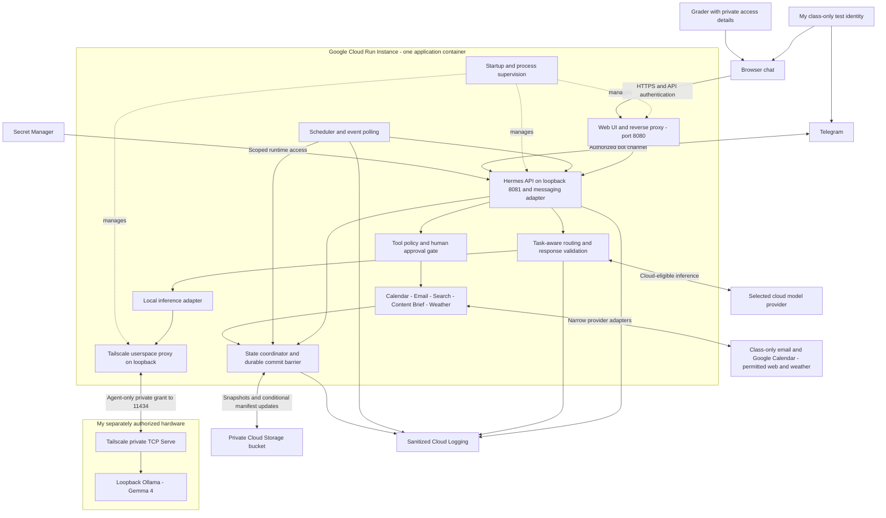
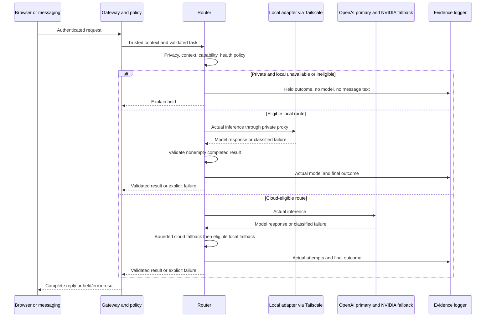
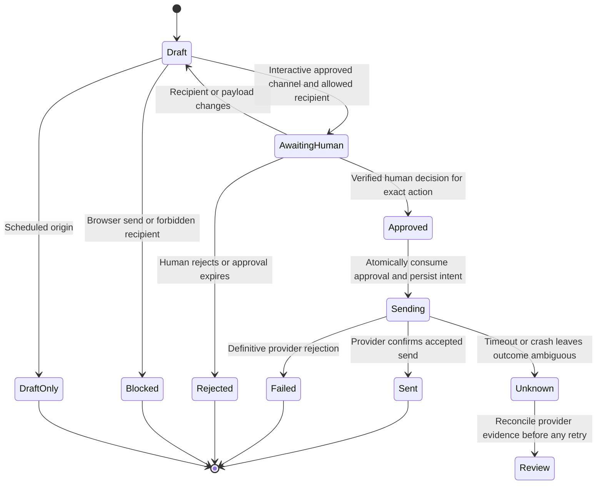

```mermaid
flowchart LR
    Dev[Approved isolated development] --> PR[Project repository pull request]
    PR --> Checks[Static and security checks - mock white-box and black-box tests]
    Checks --> Candidate[Candidate image and disposable smoke or UI tests]
    Candidate --> Review[My review of code and evidence]
    Review --> Build[Trusted approved-commit build]
    Build --> Registry[Artifact Registry immutable digest]
    Registry --> Gate[Required checks - security gate - explicit release approval - freeze check]
    Gate --> Deploy[OIDC-scoped Instance deployment]
    Deploy --> Verify[Readiness and authorized live smoke checks]
    Verify --> Record[Release record and later observation freeze]
    Verify --> Recovery[Investigate and approve compatible rollback]
```

# Monday — System Architecture

I use this document to explain the implemented boundaries, technology choices and verification contracts. Measured results are scoped in the verification record; operating evidence is collected against the final release.

## A1. Scope, assumptions, and decision status

I use **Hermes v0.22.7**, Telegram and Monday's browser interface. The runtime is one Cloud Run **Instance** in `us-west1`, with local Gemma on my Mac through Tailscale. The bucket and image registry are distinct existing resources in `us-central1`.

- My profile is fictional Alex Chen; connected accounts contain class-only data.
- My four selected features are briefing, recap, email integration and alerts.
- My fourth skill is LinkedIn Content Brief; my advanced integration is its original public skill-tap publication.
- The source describes the system and release procedure. Actual image/live checks are tied to their artifacts in the verification record and submission evidence.

## A2. Technology choices and their justification

| Component | Why I use it | Implementation |
| --- | --- | --- |
| Python 3.14 / Hermes v0.22.7 | Required compatible runtime; native gateway, scheduling, OAuth and Telegram integration. | Pinned bootstrap, `runtime.py`, `gateway_launcher.py`, `plugin.py`. |
| OpenAI OAuth / Gemma 4 E2B / NVIDIA | Task-aware hybrid operation, local privacy and bounded cloud fallback. | `routing.py`, `oauth_proxy.py`, `providers.py`. |
| FastAPI / HTTPX | Narrow authenticated edge and bounded provider adapters. | `api.py`, `integrations.py`, `notifications.py`. |
| SQLite / GCS | Transactional local state with durable generation-fenced recovery. | `state.py`, `durability.py`, `workspace.py`, `auth_checkpoint.py`. |
| Tailscale userspace proxy | Private cloud-to-laptop access without a TUN device or public Ollama. | `network.py`; fixed approved Ollama target. |
| Google OAuth / Tavily / Open-Meteo | Dedicated calendar/mail, independent search skill and briefing weather. | Fixed-origin service adapters and narrow scopes. |
| Docker / GitHub Actions / OIDC | Isolated execution, reproducible images and short-lived scoped deployment authority. | Dockerfile, workflows and release scripts. |
| Secret Manager | Runtime injection with pinned versions, separate from source and images. | Reviewed release configuration and per-secret IAM. |

The $4 target is a planning and tracking limit, not an infrastructure billing hard cap. Provider quotas bound paid attempts; the release cost review includes the whole availability period.

## A3. Whole-system topology and responsibility boundaries

My cloud host contains the public edge, native Hermes gateway and loopback policy/storage boundary. Outbound model, service and private-network paths remain separate.



## A4. Entry points, UI, and interface contracts

- **Browser:** external port 8080; static UI, authenticated `/v1/chat/completions`, health and content review. Native Hermes stays on loopback 8081; policy service stays on loopback 8090.
- **Telegram:** owner-restricted incoming messages, scheduled delivery and exact-payload `/review DRAFT_ID` approval.
- **Web approval:** the browser cannot approve or dispatch email. It can request a draft and use the supported Telegram review path.
- **Rendering:** text-based browser output prevents injected markup; Telegram uses native MarkdownV2 for model replies and escaped HTML for deterministic alerts.
- **Resource bounds:** body/response sizes, deadlines and concurrency are bounded; errors do not reflect raw provider data or credentials.

## A5. Hybrid routing, privacy, and model failure

The router evaluates privacy before long-context or reasoning preferences. Private user history, private tool context and persisted session privacy select local Gemma. Non-private long-context/reasoning work uses OpenAI OAuth; simple work uses local inference. An ordinary local failure tries OpenAI OAuth first, then NVIDIA after a transient primary failure. Private local failure is held. Each provider has a bounded attempt; a recovered local connection is reconsidered on the next eligible turn.

Hermes owns OAuth login and refresh. My proxy forwards its authenticated request and does not repurpose a ChatGPT credential as a paid API key. Each actual inference attempt records time, route, reason, model and outcome without message text. `A3_SIMULATE_PRIMARY_429` and `A3_SIMULATE_429` support reversible failure tests without exhausting a provider quota.

Ollama receives `num_ctx=65536`, `think=false`, temperature 0.2 and bounded output. My [performance report](PERFORMANCE_REPORT.md) includes full gateway/tool turns and actual route evidence.



## A6. Tool execution, email approval, and the fourth skill

The native assignment toolset exposes calendar, email read, local drafts, search, weather, memory, activity, alerts and content review/history. It does not expose shell, arbitrary Python, arbitrary HTTP, email-send approval or LinkedIn publishing.

- Email dispatch exists only behind a human-only internal route reached by the owner's Telegram button.
- The stored draft binds recipient, subject and body. Allowlist, ownership, expiry, digest and single-use claim are enforced before the provider call.
- `A3_EMAIL_ENABLED=false` blocks reads and sends before provider access and does not consume an approval.
- Scheduled jobs can prepare drafts and notify; they cannot approve themselves.
- Content-review tools publish an explicit nested schema. Required topic/body/source/claim fields prevent the underspecified-object failure found in the Gemma evaluation; the validator remains authoritative.



## A7. Proactive scheduling and delivery

| Native schedule | Time in America/Los_Angeles | Behavior |
| --- | --- | --- |
| Morning briefing | 08:00 daily | Today's events, computed 09:00–17:00 gaps, weather and prioritized email summaries. |
| Content brief | 09:00 daily | Permitted research and a sourced draft for review. |
| Recap | 20:00 daily | Recorded activity, decisions for review and tomorrow's calendar. |
| Alerts | Every five minutes | Fresh urgent email and upcoming-meeting checks with deduplication. |
| Checkpoint | Every minute | Durable state checkpoint and operational heartbeat. |

`seed_jobs.py` installs the two reviewed script entrypoints inside `$HERMES_HOME/scripts`, preserving Hermes’s script-directory restriction, and reconciles these native jobs without erasing history or resuming an intentional pause. A missing owner pauses notification jobs; duplicate managed names stop initialization. Cron response wrapping is disabled. Concise bold headings and Unicode bullets replace job IDs and management footers.

Weather is fetched anew for each invocation, checked against the current local date and a three-hour observation freshness bound, and validated for numeric values and units. Only weather GETs retry once on transport/timeouts/5xx within an 18-second total deadline; 429 and configuration errors do not trigger repeated requests. Failed weather remains explicitly unavailable.

Calendar gaps merge overlapping busy intervals and honor all-day/transparent events; truncated or malformed data reports unavailable. Email selection includes starred mail and unread mail outside routine promotion/social categories. It does not implement a date cutoff. Delivery distinguishes success, failure and uncertainty; timeouts do not justify blind replay.

## A8. Persistence, concurrency, and restoration

The policy store uses SQLite transactions and consistent snapshots. The native workspace includes Hermes context, session and schedule files. A single writer commits versioned GCS checkpoints using generation preconditions; stale owners cannot overwrite newer state. Failed durability poisons the writer rather than acknowledging a success it cannot preserve.

Startup restores committed state before filling missing native defaults. Existing profiles survive initialization. Separate local/cloud OAuth grants avoid rotating-token reuse; auth checkpoints track rotation uncertainty and recovery. Controlled release checks verify new-conversation recall, job/network identity and native OAuth after an actual Instance restart.

```mermaid
sequenceDiagram
    participant W as Chat or scheduled writer
    participant S as State coordinator
    participant D as Local workspace and journal
    participant B as Private Cloud Storage
    W->>S: Mutation with operation ID and expected revision
    S->>D: Serialize update and consistent checkpoint
    D-->>S: Snapshot with sequence and checksums
    S->>B: Upload immutable snapshot
    B-->>S: Snapshot stored
    S->>B: Commit manifest with generation precondition
    alt Commit succeeds
        B-->>S: New manifest generation
        S-->>W: Durable acknowledgement
    else Conflict or storage failure
        B-->>S: Rejected or unavailable
        S-->>W: No durable success; stop unsafe writes/actions
    end
```

## A9. Security architecture and release gates

My [security audit](SECURITY_AUDIT.md) maps ten risks to controls, tests and residual limits. The [finding register](SECURITY_REGISTER.md) retains stable IDs and image-specific dispositions.

- Non-root execution, no effective capabilities and no-new-privileges.
- No model-callable shell, arbitrary network client, send approval or social publisher.
- Fixed service origins, bounded payloads, safe rendering and sanitized logs/errors.
- Scoped IAM, runtime secret injection and excluded private state/build paths.
- Finite provider quotas and fail-closed release/observation gates.
- Raw vulnerability reports retained; unknown Critical/High, drift and expired decisions block release.

The three injection tests deliberately simulate a compromised model's attempted actions against the real policy layer. They do not establish universal semantic resistance to every source prompt.

## A10. Runtime lifecycle, availability, and the observation window

The supervisor initializes policy/storage, restores state, fills missing defaults, starts private networking and native schedules, then starts Hermes and the public edge. A child failure terminates its peers; graceful shutdown uses bounded waits. A supervision wait is not the proactive scheduler.

Release uses a reviewed immutable image and `gcloud beta run instances deploy` in **us-west1**. The deployment gate rejects other regions, even syntactically valid ones. Registry and bucket locations are independent.

A controlled recovery check occurs before observation. The live acceptance record binds the actual image and region. I then freeze the release configuration, commit and push it, and verify the remote gate before recording the real observation start time. The start helper writes only ignored operational evidence. No planned three-hour restarts run during grading; actual failures and gaps remain evidence.

## A11. Isolated development and GitHub delivery

My application work and tests execute in approved Docker containers with project-only mounts. Tests use disposable state, disabled networking where appropriate, and agreed 4-CPU/4-GiB limits.

GitHub CI validates source. A separately approved publish job builds native amd64, runs tests, checks runtime/vulnerabilities and publishes an immutable image. The deploy job uses required production review, main-branch restrictions and exact ID-qualified OIDC claims. Publication alone does not deploy an Instance.

The release configuration pins image, region, secret versions and spending authorization. After freeze, I collect evidence without modifying the deployed artifact or source repository.



## A12. Evidence architecture, reports, and submission

| Artifact | Purpose |
| --- | --- |
| PROCESS_LOG.md | My tools, 200–300-word narrative, file attribution, verification and personal reflection. |
| SECURITY_AUDIT.md / SECURITY_REGISTER.md | Threat model, attack evaluation, findings, mitigations and residual limits. |
| PERFORMANCE_REPORT.md / evaluation/model-comparison.json | Three task types, observed replies/timings, actual model routes and cost/resource interpretation. |
| PERSONALIZATION_PROFILE.md / profiles/classroom/ | Sanitized fictional profile and native context snapshots. |
| Source package | Reproducible code, lock, configuration, skills and setup instructions, excluding secrets and private backups. |
| Operational evidence and video | Real final-model logs, interval-wide availability, deployed demonstrations and the prescribed Zoom sequence. |

Operational evidence is collected separately from the frozen source. Passwords, API access keys and other grader secrets belong only in Brightspace Comments using the supplied template. [Grader instructions](GRADER_ACCESS.md)

## A13. Conditional branches and alternatives

Hermes, Telegram and original-skill publication are my selected branches. OpenClaw-specific setup, A2A and three-platform continuity remain unselected alternatives in the requirements, not partially implemented features. Calendar intelligence and a full personal knowledge base are not counted among my selected four advanced features.

## A14. Validation strategy and release gates

My checks cover unit, integration, smoke, UI, regression, white-box and black-box behavior, plus bounded load/stress and recovery. The [verification record](IMPLEMENTATION_STATUS.md) states the actual environment and results. The [release checklist](FINAL_REVIEW.md) applies the checks to the final Instance and records evidence outside the frozen repository.

Required invariants include no private cloud inference under the hold policy, no unauthorized email send, no automatic social publication, no false durability acknowledgement and no substituted image/region. A passing model request is distinct from successful tool execution or notification delivery.

## A15. Requirement-by-requirement architecture coverage

Each stable requirement ID maps to the relevant component discussion and its acceptance evidence. Conditional branches retain their selection rules.

| Requirement ID | Architecture location | Acceptance evidence |
| --- | --- | --- |
| CORE-01 | [A1](#a1-scope-assumptions-and-decision-status), [A13](#a13-conditional-branches-and-alternatives) | Selected platform, effective runtime version, configuration, and working gateway. |
| CORE-02 | [A3](#a3-whole-system-topology-and-responsibility-boundaries), [A11](#a11-isolated-development-and-github-delivery) | My deployed resource type, image, startup command, port, restart behavior, and health inspection. |
| CORE-03 | [A2](#a2-technology-choices-and-their-justification), [A5](#a5-hybrid-routing-privacy-and-model-failure) | Final-primary and fallback calls, actual model/outcome logs, safe failure tests and final-configuration artifacts. |
| CORE-04 | [A5](#a5-hybrid-routing-privacy-and-model-failure) | Valid reproducible local reply, full tool turn, actual hardware/model identity, ollama list/ps and deployed private-path evidence. |
| CORE-05 | [A3](#a3-whole-system-topology-and-responsibility-boundaries), [A5](#a5-hybrid-routing-privacy-and-model-failure) | Completed cloud-to-laptop inference and responding model identity, alongside network configuration. |
| CORE-06 | [A5](#a5-hybrid-routing-privacy-and-model-failure), [A14](#a14-validation-strategy-and-release-gates) | Deterministic routing tests, live calls, logs, and comparison across at least three task types. |
| CORE-07 | [A5](#a5-hybrid-routing-privacy-and-model-failure) | Controlled flag/config/mock HTTP 429 test, local result, and successful removal of the injected condition. |
| CORE-08 | [A5](#a5-hybrid-routing-privacy-and-model-failure), [A10](#a10-runtime-lifecycle-availability-and-the-observation-window) | Live non-private request succeeds through cloud with Ollama unavailable. |
| CORE-09 | [A5](#a5-hybrid-routing-privacy-and-model-failure), [A12](#a12-evidence-architecture-reports-and-submission) | Local-down test proves the selected policy; no unsupported privacy claims. |
| CORE-10 | [A5](#a5-hybrid-routing-privacy-and-model-failure), [A12](#a12-evidence-architecture-reports-and-submission) | My final-response/model-call review, request timestamp correlation, and log-content leakage check. |
| CORE-11 | [A2](#a2-technology-choices-and-their-justification), [A5](#a5-hybrid-routing-privacy-and-model-failure) | Served context, memory use, cold/warm timing and a complete tool-calling turn without hidden truncation or empty output. |
| CORE-12 | [A13](#a13-conditional-branches-and-alternatives) | Actual diagnostics and credit limitation; no invented local result or automatic full-credit accommodation. |
| FUNC-01 | [A4](#a4-entry-points-ui-and-interface-contracts) | Live message/reply through the deployed agent and demo video. |
| FUNC-02 | [A1](#a1-scope-assumptions-and-decision-status), [A6](#a6-tool-execution-email-approval-and-the-fourth-skill) | README inventory of what I created, installed/configured and how each skill is used, with deployment/video evidence. |
| FUNC-03 | [A1](#a1-scope-assumptions-and-decision-status), [A7](#a7-proactive-scheduling-and-delivery) | Feature-to-test mapping, useful results from synthetic test accounts, trigger/execution/delivery evidence. |
| FUNC-04 | [A7](#a7-proactive-scheduling-and-delivery) | Scheduler configuration and autonomous trigger/execution logs. |
| FUNC-05 | [A7](#a7-proactive-scheduling-and-delivery), [A12](#a12-evidence-architecture-reports-and-submission) | All three are actually delivered in the video, following the run-now allowances below. |
| FUNC-06 | [A6](#a6-tool-execution-email-approval-and-the-fourth-skill) | Sanitized two-account/calendar inventory and synthetic fixtures; no personal/USC inbox or real outreach. |
| FUNC-07 | [A6](#a6-tool-execution-email-approval-and-the-fourth-skill) | Unapproved send denied, approved permitted send scoped to allowed test recipients, disallowed recipient denied, and unattended job completes without sending/hanging. |
| FUNC-08 | [A6](#a6-tool-execution-email-approval-and-the-fourth-skill), [A7](#a7-proactive-scheduling-and-delivery) | Delivered briefing with weather from the selected integration. |
| FUNC-09 | [A6](#a6-tool-execution-email-approval-and-the-fourth-skill), [A12](#a12-evidence-architecture-reports-and-submission) | Auth/refresh and read/draft tests, scope inventory, code-enforced approval gate. |
| FEAT-01 | [A7](#a7-proactive-scheduling-and-delivery) | Schedule fires and delivers current integrated content; run-now video invokes the scheduled job. |
| FEAT-02 | [A7](#a7-proactive-scheduling-and-delivery) | Scheduled recap grounded in activity logs; video can run the scheduled job early. |
| FEAT-03 | [A6](#a6-tool-execution-email-approval-and-the-fourth-skill), [A7](#a7-proactive-scheduling-and-delivery) | Synthetic inbox, summary, draft, urgency flag, and approval-control tests. |
| FEAT-04 | [A7](#a7-proactive-scheduling-and-delivery) | A fresh synthetic trigger in my test setup, followed by an unsolicited alert and trigger/execution evidence. |
| FEAT-05 | [A13](#a13-conditional-branches-and-alternatives) | Synthetic conflicting events, slot suggestions, and context preparation examples. |
| FEAT-06 | [A13](#a13-conditional-branches-and-alternatives) | A new synthetic fact in my test setup, its stored representation, and recall across sessions/restarts. |
| OPS-01 | [A8](#a8-persistence-concurrency-and-restoration) | Bucket/mount configuration, runtime permissions, and observed writes. |
| OPS-02 | [A8](#a8-persistence-concurrency-and-restoration) | New fact stored durably, instance restart, new conversation recalls it from restored state. |
| OPS-03 | [A8](#a8-persistence-concurrency-and-restoration) | Concurrent update/restart tests for the selected single-writer, version-aware, journal, or equivalent strategy. |
| OPS-04 | [A3](#a3-whole-system-topology-and-responsibility-boundaries), [A10](#a10-runtime-lifecycle-availability-and-the-observation-window) | My deployed-setting inspection and verified gateway, tools, and both inference paths. |
| OPS-05 | [A10](#a10-runtime-lifecycle-availability-and-the-observation-window) | Process/container peaks, headroom, concurrency and allocation rationale in README/report, with actual cost monitoring. |
| OPS-06 | [A10](#a10-runtime-lifecycle-availability-and-the-observation-window) | Real time bounds, build/model timeline, interval-wide availability/job/lifecycle evidence and independent grading access. Old-model logs cannot be relabeled. |
| OPS-07 | [A10](#a10-runtime-lifecycle-availability-and-the-observation-window) | Honest lifecycle/gap records and recovery/state evidence, without claiming an interrupted interval was uninterrupted. |
| OPS-08 | [A10](#a10-runtime-lifecycle-availability-and-the-observation-window), [A12](#a12-evidence-architecture-reports-and-submission) | Sanitized export covering the run, backed by Cloud Logging/bucket/job history; no reconstruction of a fictitious start time. |
| OPS-09 | [A10](#a10-runtime-lifecycle-availability-and-the-observation-window) | Final configuration has no preventive restart job; capacity/load evidence and incident reporting remain available. |
| OPS-10 | [A10](#a10-runtime-lifecycle-availability-and-the-observation-window), [A11](#a11-isolated-development-and-github-delivery) | Stable access/configuration, laptop-off cloud checks, freeze controls and truthful incident records. |
| SEC-01 | [A9](#a9-security-architecture-and-release-gates), [A10](#a10-runtime-lifecycle-availability-and-the-observation-window) | Container configuration, startup isolation evidence, and audit. |
| SEC-02 | [A9](#a9-security-architecture-and-release-gates) | My mapping of implemented controls to the menu and verification results. |
| SEC-03 | [A6](#a6-tool-execution-email-approval-and-the-fourth-skill) | Positive/negative send tests, bypass attempts through available tools, and documented approval path. |
| SEC-04 | [A1](#a1-scope-assumptions-and-decision-status), [A9](#a9-security-architecture-and-release-gates) | Test-data review and connected-account inventory. |
| SEC-05 | [A2](#a2-technology-choices-and-their-justification), [A9](#a9-security-architecture-and-release-gates), [A12](#a12-evidence-architecture-reports-and-submission) | Secret-handling/configuration review and sanitized packaging/build-context checks. |
| SEC-06 | [A5](#a5-hybrid-routing-privacy-and-model-failure), [A9](#a9-security-architecture-and-release-gates) | Authorized deployed-agent success plus unauthorized/LAN rejection checks. |
| SEC-07 | [A9](#a9-security-architecture-and-release-gates), [A12](#a12-evidence-architecture-reports-and-submission) | Audit-to-implementation traceability and reproducible security checks. |
| SEC-08 | [A9](#a9-security-architecture-and-release-gates) | Attack fixtures and observed outcomes; include incoming email/calendar/web content and memory risks as appropriate. |
| ADV-01 | [A1](#a1-scope-assumptions-and-decision-status), [A6](#a6-tool-execution-email-approval-and-the-fourth-skill) | Public pinned artifact plus clean-install/run evidence; attribute reused material. Publication requires my separate authorization. |
| ADV-02 | [A13](#a13-conditional-branches-and-alternatives) | Demonstrated cross-assistant request/result and independent implementation evidence. |
| ADV-03 | [A13](#a13-conditional-branches-and-alternatives), [A12](#a12-evidence-architecture-reports-and-submission) | Three-service Bluebird exchange below; persistence tests and working additional services. |
| HERMES-01 | [A4](#a4-entry-points-ui-and-interface-contracts) | Chrome opens chat, health works, authenticated chat produces a complete reply. |
| HERMES-02 | [A4](#a4-entry-points-ui-and-interface-contracts), [A10](#a10-runtime-lifecycle-availability-and-the-observation-window) | Startup, subprocess failure, graceful termination, and recovery checks. |
| HERMES-03 | [A4](#a4-entry-points-ui-and-interface-contracts) | Missing/wrong-key rejection and valid-key chat; key not visible in assets or recording. |
| HERMES-04 | [A4](#a4-entry-points-ui-and-interface-contracts), [A6](#a6-tool-execution-email-approval-and-the-fourth-skill) | Web send request returns a block promptly without hanging; messaging request still shows approval controls. |
| OPENCLAW-01 | [A13](#a13-conditional-branches-and-alternatives) | Chrome opens dashboard directly through the intended shared identity. |
| OPENCLAW-02 | [A13](#a13-conditional-branches-and-alternatives) | Access policy and reachability tests for permitted/forbidden destinations. |
| OPENCLAW-03 | [A13](#a13-conditional-branches-and-alternatives) | Restart retains machine name/identity and existing grader URL; auth key not exposed. |
| OPENCLAW-04 | [A13](#a13-conditional-branches-and-alternatives) | Config validation, startup/Serve logs, working identity recognition and post-restart dashboard. |
| OPENCLAW-05 | [A13](#a13-conditional-branches-and-alternatives) | Reusable share setup and pre-submission access check; keep access through regrades. |
| ACCESS-01 | [A12](#a12-evidence-architecture-reports-and-submission) | My completed private Brightspace Comments template, with no secret values in project Markdown. |
| ACCESS-02 | [A12](#a12-evidence-architecture-reports-and-submission) | My grader-style login test in an Incognito window of a different browser, excluding consumed codes and retaining four unused codes for Path 2. |
| ACCESS-03 | [A12](#a12-evidence-architecture-reports-and-submission) | Token lifetime/reauthorization plan, external login test, and post-grading cleanup plan. |
| VIDEO-01 | [A12](#a12-evidence-architecture-reports-and-submission) | My final recording review for identity, runtime version, desktop visibility, and all steps below. |
| VIDEO-02 | [A12](#a12-evidence-architecture-reports-and-submission) | Media duration and one final recording. |
| VIDEO-03 | [A5](#a5-hybrid-routing-privacy-and-model-failure), [A12](#a12-evidence-architecture-reports-and-submission) | Four requests, shutdown/recovery sequence, and matching successful final-call logs except held requests. |
| VIDEO-04 | [A12](#a12-evidence-architecture-reports-and-submission) | Readable log output correlated to all four requests; held request has no model call. |
| VIDEO-05 | [A12](#a12-evidence-architecture-reports-and-submission) | Visible terminal evidence in recording. |
| VIDEO-06 | [A7](#a7-proactive-scheduling-and-delivery), [A12](#a12-evidence-architecture-reports-and-submission) | Delivered messages and trigger/job evidence in recording. |
| VIDEO-07 | [A12](#a12-evidence-architecture-reports-and-submission) | Full video review before submission. |
| VIDEO-08 | [A12](#a12-evidence-architecture-reports-and-submission) | Correct filename and upload checklist, subject to packaging clarification below. |
| SUB-01 | [A12](#a12-evidence-architecture-reports-and-submission) | Archive inventory and README run/setup/deployment instructions sufficient for TA verification. |
| SUB-02 | [A12](#a12-evidence-architecture-reports-and-submission) | Reproducible sanitized source package and setup review. |
| SUB-03 | [A10](#a10-runtime-lifecycle-availability-and-the-observation-window), [A12](#a12-evidence-architecture-reports-and-submission) | Model/build/time traceability, final-selection logs/video, persistence evidence and private grader credentials. |
| SUB-04 | [A9](#a9-security-architecture-and-release-gates), [A12](#a12-evidence-architecture-reports-and-submission) | At least five risks, implemented/residual mitigations, send approval/allowlist, isolation, and conditional attack results. |
| SUB-05 | [A12](#a12-evidence-architecture-reports-and-submission), [A14](#a14-validation-strategy-and-release-gates) | Measured full-agent-turn results, justified quality assessment, and cost assumptions distinguished from actual charges/entitlements. |
| SUB-06 | [A8](#a8-persistence-concurrency-and-restoration), [A12](#a12-evidence-architecture-reports-and-submission) | Platform-specific files with meaningful synthetic customization and any hardware accommodation. |
| SUB-07 | [A12](#a12-evidence-architecture-reports-and-submission) | Content and word-count review; an accurate process history and my understanding, written in my own voice. |
| SUB-08 | [A12](#a12-evidence-architecture-reports-and-submission) | Video checklist plus publication/A2A/multi-platform evidence. |
| INTEGRITY-01 | [A12](#a12-evidence-architecture-reports-and-submission), [A13](#a13-conditional-branches-and-alternatives) | Honest Process Log, independent source/deliverables, and explanations I have reviewed. |
| INTEGRITY-02 | [A12](#a12-evidence-architecture-reports-and-submission) | Attribution review of starter/framework/external code and process entries. |
| POLICY-01 | [A1](#a1-scope-assumptions-and-decision-status), [A12](#a12-evidence-architecture-reports-and-submission) | My confirmed course schedule, timezone, and remaining grace balance before final submission planning. |
| USER-01 | [A1](#a1-scope-assumptions-and-decision-status), [A11](#a11-isolated-development-and-github-delivery) | Codex needs my permission for external filesystem access or global installation. My temporary/cache outputs stay inside the project. |
| USER-02 | [A1](#a1-scope-assumptions-and-decision-status), [A14](#a14-validation-strategy-and-release-gates) | Routine implementation and CI configuration can proceed. My GCP project and $4 total ceiling are confirmed; release approval, publication and submission remain separate gates. |
| USER-03 | [A12](#a12-evidence-architecture-reports-and-submission), [A16](#a16-references-and-document-review) | My files use `AGENTS.md`, `REQUIREMENTS.md`, `README.md`, and `PROCESS_LOG.md`, with lowercase directories such as `agent_docs/`. Original and tooling-required names are preserved. |
| USER-04 | [A16](#a16-references-and-document-review) | My affected requirements, plans, status, setup/run instructions, reports, and process history are synchronized within each approved change set, rather than deferred to final cleanup. |
| USER-05 | [A14](#a14-validation-strategy-and-release-gates) | My verification record must distinguish results, failures, deferrals, and justified not-applicable checks. I will agree workload/resource/cost limits before load/stress runs. |
| USER-06 | [A12](#a12-evidence-architecture-reports-and-submission), [A15](#a15-requirement-by-requirement-architecture-coverage) | My review needs requirement-to-code-to-test-to-evidence traceability, correctness/security checks across synthetic data, outputs, state, and logs, and explicit gaps and grading risks. The role in AGENTS.md supports my understanding; completion needs evidence. The instructor determines the final grade, and my target does not expand authorization. |
| USER-07 | [A12](#a12-evidence-architecture-reports-and-submission), [A16](#a16-references-and-document-review) | The writing rule in AGENTS.md applies to existing and future Markdown. My plans stay distinct from completed work; actual AI assistance, source attribution, commands, prompts, and technical requirements remain accurate. |
| USER-08 | [A11](#a11-isolated-development-and-github-delivery) | A container/VM boundary with project-scoped source, synthetic fixtures, disposable state, controlled network/credentials, and no personal host mounts. A Python virtual environment alone is insufficient. Local Docker host-side writes, remote provisioning, and source transfer need explicit approval. |
| USER-09 | [A14](#a14-validation-strategy-and-release-gates) | Internal policy/branch/error-path tests plus observable UI/API/messaging behavior checks. Unit, integration, smoke, UI, load, stress, and regression remain applicable categories; mock and live results are distinguished. |
| USER-10 | [A11](#a11-isolated-development-and-github-delivery) | Isolated validation, immutable builds, approved Instance deployment, smoke checks and controlled recovery. Workflow validation/publication, restricted cloud credentials and production protections are verified; the each new image and deployed system must pass its own release checks. The grading freeze remains enforced; Q10 distinguishes minor non-model fixes from primary-model changes requiring new evidence. |
| USER-11 | [A4](#a4-entry-points-ui-and-interface-contracts) | DESIGN.md includes architecture, a chat wireframe, states, accessibility goals, and Telegram/Discord integration. The required messaging channel and platform-specific browser grader interface are both retained; a custom dashboard and WhatsApp are not assumed requirements. |
| USER-12 | [A1](#a1-scope-assumptions-and-decision-status), [A10](#a10-runtime-lifecycle-availability-and-the-observation-window) | I distinguish that deadline from Q07's End Date (deadline + 2) and subsequent 48-hour grader retest. I do not invent grace entitlement, a first-test hour, or a requirement to delay submission solely to repeat a pre-submission soak for a minor fix. |
| USER-13 | [A9](#a9-security-architecture-and-release-gates) | SECURITY_REGISTER.md separates risks from findings and records affected artifacts, severity, evidence, ownership, fixes, and retests. Applicable code/dependency/secret/image/configuration and sandbox behavioral checks gate releases; unresolved Critical/High or behavior-based blockers and incomplete required checks stop release. Permitted lower-severity residual risks need my explicit recorded decision. |
| USER-14 | [A6](#a6-tool-execution-email-approval-and-the-fourth-skill), [A7](#a7-proactive-scheduling-and-delivery) | LinkedIn Content Brief researches permitted sources, selects relevant nonduplicate topics, preserves provenance, drafts in a configured voice, and delivers to my review channel with persistent history. Assignment data remains synthetic; no direct LinkedIn search, personal-account access, or publishing in the initial scope. Approved API access would be a separate future decision. Outreach improvement is a goal, not a promised result. |
| USER-15 | [A11](#a11-isolated-development-and-github-delivery), [A18](#a16-references-and-document-review) | Project-local Git identity/configuration, explicit staging, appropriate checks, descriptive commits, and verified pushes; synchronize Markdown before each commit. No force-push/history rewrite or deployment is implied. Supplied course materials, secrets and generated/private state are excluded from the initial baseline; repository visibility/protections need verification before application publication. |

## A16. References and document review

I use the five local PDFs and the instructor clarifications indexed in [REQUIREMENTS.md](REQUIREMENTS.md). Current version behavior is verified against the installed source and relevant official documentation.

- [Hermes v0.22.7 source](https://github.com/NousResearch/hermes-agent/tree/v0.22.7).
- [Cloud Run Instance regions and lifecycle](https://docs.cloud.google.com/run/docs/instances/create-and-manage-instances).
- [Tailscale Cloud Run networking](https://tailscale.com/docs/install/cloud/cloudrun).
- [Telegram formatting](https://core.telegram.org/bots/api#formatting-options).
- [Google API scopes](https://developers.google.com/workspace/gmail/api/auth/scopes).

The November 17 source check caught the unsupported us-central1 Instance target and corrected it to us-west1. This does not require moving the existing Artifact Registry or storage bucket.

## A17. Appendix — technology and development-stack overview

| Technology | General overview and role |
| --- | --- |
| Git / GitHub | Version history, review and recovery of authored source. |
| GitHub Actions / OIDC | Repeatable checks and short-lived identity for explicitly reviewed releases. |
| Docker / uv / Python | Filesystem/process isolation plus pinned dependency/runtime installation. |
| Hermes | Agent orchestration, conversations, native schedules, OAuth and messaging. |
| HTML / CSS / JavaScript / FastAPI | Accessible browser UI and authenticated edge with narrow interfaces. |
| HTTPX | Explicit fixed-origin provider clients with timeouts and response bounds. |
| Gemma / Ollama | Local model inference with a verified serving context and constrained resources. |
| OpenAI OAuth / NVIDIA | Primary cloud inference and a bounded secondary provider. |
| Tailscale | Private agent-to-laptop transport; it does not replace application authorization. |
| SQLite / GCS | Transactional local state and durable generation-aware recovery. |
| Secret Manager / IAM | Scoped runtime credentials and cloud permissions. |
| Google APIs / Tavily / Open-Meteo | Test calendar/mail, independent public research and weather. |
| Pytest / Ruff / Bandit / Chromium / Trivy | Behavioral, static, browser and image checks with distinct scopes. |
| Markdown / Mermaid | Readable specifications, reports, traceability and editable diagrams. |
