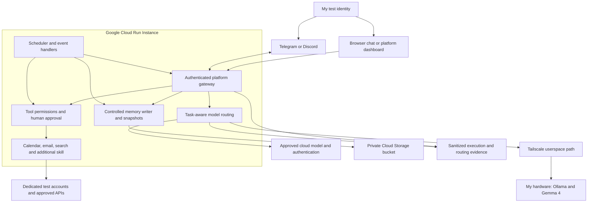
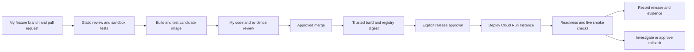

# My Assignment 3 Design

## My November 17 regression and implementation update

I asked to prioritize implementation and leave my personal reflection and final submission writing for tomorrow. The current source passes **132 offline tests in 67.51 seconds**, with **74% measured combined statement/branch coverage** in the test process. Separate native subprocess checks, browser tests and earlier live checks have their own scope. I fixed independent alert-source failures, malformed delivery acknowledgements, failed-chat draft loss, late draft responses after sign-out, and cloud-auth readiness. My content workflow now has an original claim-to-source review helper. Alert sources run concurrently with a 30-second limit each, followed by a 55-second delivery budget. Cancellation marks an in-flight send unknown and leaves unattempted alerts pending; these limits cover network waits, not arbitrary local storage stalls.

My bounded mock load/stress/recovery checks and latest-source Chromium checks pass. Ruff and Bandit pass; the installed-package advisory check reports no known vulnerabilities in its scanned scope, excluding editable project/Hermes packages. A separate runtime image scan found OS and bundled-component advisories. The Debian 13 baseline, removal of the unused installer, and pinned zlib update cleared the scanned Critical findings and affected bundled installer packages, but **untriaged High findings still block release**. No claim of zero vulnerabilities or complete rubric coverage is justified.

I explicitly authorized publication of my reviewed original Hermes skill after its native safety scan and isolated installation passed. My public tap was fetched at commit 5ba6fa6 and passed the native safety scan. A fresh isolated Hermes profile then used Gemma to execute the installed helper successfully; the first ambiguous invocation failed and the explicit helper-command retry passed. This standalone skill check served a 4,096-token context, so it does not replace my separate 65,536-token application check or required video. My existing running local assistant remains on its earlier image; the new source and image checks do not silently update it. Live Cloud Run/GCS acceptance, bounded fallback/search usage, autonomous delivery evidence, final-model performance comparison, the genuine 48-hour record and video remain open. Earlier test/build counts below are historical checkpoints; acceptance columns describe work still to prove.

## My November 17 integration checkpoint

My selected primary is Hermes OpenAI browser OAuth with `gpt-6.1-sol`; a real synthetic inference passed. NVIDIA remains fallback and Gemma 4 E2B handles local work. Google OAuth refresh, Gmail identity and dedicated-calendar access passed; the Telegram owner is configured. My project is `assignment3-515003` with a $4 total ceiling. My Mac is connected to my own Tailscale network, and isolated Google Cloud CLI sign-in verified the active project and enabled billing. Private Gemma inference passed through an isolated Tailscale client, while an excluded tag was blocked. The separate cloud OAuth login is saved; cloud storage recovery and the actual Cloud Run path remain unverified. Published implementation checkpoints passed GitHub CI. Paid API calls remain disabled. Deployment and final evidence are unfinished; [my implementation status](IMPLEMENTATION_STATUS.md) distinguishes verified results from remaining work.

Status: implementation is underway in my approved Docker sandbox. I selected Hermes, Telegram, Gmail, and a dedicated Google Calendar. The Daylight browser interface implements the proposed soft neumorphic styling, plain-text chat, visible connection/error states, and Telegram-only email approval. [IMPLEMENTATION_STATUS.md](IMPLEMENTATION_STATUS.md) distinguishes implemented behavior from pending live evidence. Cloud deployment and the 48-hour run have not started.

Last updated: November 17, 2026.

My design follows [REQUIREMENTS.md](REQUIREMENTS.md) and the boundaries in [AGENTS.md](AGENTS.md). My [detailed architecture](ARCHITECTURE.md) expands the topology into component/technology rationale, routing and approval policies, state recovery, deployment, evidence, and a map of all 94 requirement IDs. Source keys D, G, S, R, V, and Z refer to the assignment-source register in REQUIREMENTS.md. Choices labeled proposed are not final selections.

## 1. My immediate priorities

I want a useful personal assistant with a simple interface, reliable deployment, and evidence for the full rubric. The deadline I confirmed is **November 17, 2026, at 11:59 PM**. For planning, I am using **America/Los_Angeles**, my current timezone; the course timezone and number of remaining grace days still need confirmation.

My operational evidence has not started. Q07 places grader checks after End Date (deadline + 2) and again 48 hours later. I prepare the final deployment and retain genuine logs/access through that period and regrades; I do not impose an unsupported deadline-minus-48-hours rule. Q09 requires fresh logs/video after a primary-model change; Q10 exempts minor non-model fixes from a new full run. Exact grading time and grace balance remain unknown. [CLARIFICATIONS.md](CLARIFICATIONS.md)

To reduce last-minute deployment work, my plan brings an initial cloud deployment forward, after a small version passes its checks. I will build the remaining functionality in verified increments, then freeze a release for the real observation window. CI/CD can automate repeatable work; it cannot guarantee a grade, remove cloud startup time, or manufacture uptime evidence.

## 2. The two interfaces my assignment needs

My assistant needs **both a messaging integration and a browser interface**. A completely custom dashboard is optional; accessible browser chat for grading and the prescribed routing demo is not. [FUNC-01, HERMES-01, OPENCLAW-01, VIDEO-03]

| Surface | Role in my project | Design implication |
| --- | --- | --- |
| Telegram or Discord | Required conversation channel and a natural destination for briefings, alerts, recaps, and supported human approvals. | At least one must work through my deployed agent. A website alone does not satisfy this requirement. |
| Hermes browser chat | If I choose Hermes, graders use the supplied web UI/reverse-proxy pattern with a privately supplied API key. | I can apply the requested visual styling to this small interface while preserving its backend contract. |
| OpenClaw dashboard | If I choose OpenClaw, graders enter its dashboard through the specified Tailscale identity/access flow. | My initial scope would use the existing dashboard. A separate custom frontend or upstream theme modification would be an additional decision. |
| WhatsApp | A possible extra messaging channel, subject to supported integration and account setup. | WhatsApp alone does not replace the required Telegram/Discord channel. I have not selected or verified it. |

These distinctions come from D pp. 2, 8 and G pp. 3-20, 23-28. My browser UI does not count toward the option requiring three messaging platforms.

### Proposed starting point

My selected combination is **Hermes + Telegram + Daylight browser chat**. The browser and real local-model integration have been exercised; live messaging and cloud deployment remain pending.

If I prefer OpenClaw, the same architecture and test strategy still apply, but the grader-access branch and UI implementation change. I will approve the platform before implementation.

## 3. How I would use the assistant

My fictional profile will describe a student managing a small project and a synthetic schedule. Real personal details, inboxes, calendars, and private files stay outside the assistant.

1. **Morning:** My briefing arrives in Telegram with today's synthetic meetings, open time slots, weather, and concise email summaries.
2. **During the day:** I ask questions through Telegram or browser chat. The router chooses local or cloud inference from task properties and the documented outage policy.
3. **Before a meeting:** A scheduled/event-triggered alert arrives without my asking for it.
4. **Email review:** The assistant prepares a draft. A supported messaging approval flow lets me review the exact recipient and content before a send; browser chat offers a draft or directs me to messaging.
5. **Evening:** My recap reflects actual completed work, unresolved decisions, and tomorrow's schedule.

My proposed four advanced features are morning briefing, end-of-day recap, email integration, and proactive alerts. My skill floor still includes calendar, email, web search, and a fourth meaningful skill. Weather remains part of the briefing regardless of how the selected framework packages it. [FUNC-02/03/05/08; FEAT-01 through FEAT-04]

My proposed fourth skill is now **LinkedIn Content Brief**, reflecting my interest in a daily outreach draft. It would research a topic, suggest an angle, and deliver an original, source-backed post draft for my review. Calendar, email, and web search remain the other three required skills; this skill adds topic selection, synthesis, drafting, and history rather than merely renaming web search. Weather remains a separate briefing capability.

### My LinkedIn Content Brief skill

My goal is a useful daily draft, not automatic engagement or a promise of increased reach. For the assignment, the profile, interests, examples, and draft history remain synthetic. I will not connect my personal LinkedIn account, scrape its session, or create a fake LinkedIn identity for testing.

| Stage | Proposed behavior |
| --- | --- |
| Inputs | My configured synthetic audience, topics, tone, desired length, excluded subjects, and draft history; no personal inbox/profile data. |
| Research | Permitted public web/RSS sources, preferably original announcements or technical sources, plus material I am authorized to supply. My web-search skill remains a separate dependency. |
| Selection | A short list of relevant topics with dates, source links, and reasons, excluding recent duplicates. Relevance is assessed against the synthetic profile, not inferred from scraped people. |
| Draft | One primary post with an opening, supported takeaway, and optional discussion question/hashtags. A separate research note maps factual claims to sources and marks uncertainty. No invented personal achievements, results, or engagement metrics. |
| Review | A draft card in browser chat and a notification through the selected messaging channel. Proposed actions are Copy draft, Revise, and Dismiss; there is no LinkedIn Publish action. |
| Schedule | One draft-generation job per configured local day, with timezone, bounded retries, and a deduplication key. A manual request can regenerate a draft without being mislabeled as scheduled delivery. |
| Memory | Draft IDs, source references/dates, topic fingerprints, and review status in controlled persistent state. Content history follows the same session/isolation/snapshot rules as other memory. |
| Failure | If usable sources are absent or a claim is unsupported, my assistant explains the gap rather than inventing a trend or a finished post. |

Direct LinkedIn search is **not included in the initial implementation**. LinkedIn's official policy prohibits unauthorized scraping/website automation and fake accounts. I will not work around that through browser cookies or a third-party scraping service. [LinkedIn automation policy](https://www.linkedin.com/help/linkedin/answer/a1341387/prohibited-software-and-extensions)

The documented Posts API supports posting/retrieval with specific permissions; member-reading access is restricted, and the documented author retrieval is not evidence of unrestricted keyword search across LinkedIn. My inference is that native LinkedIn search should not be a deadline-critical dependency without a verified authorized endpoint and approved app access. Any later API integration needs a supported use case, current permissions, and separate approval. [LinkedIn Posts API](https://learn.microsoft.com/en-us/linkedin/marketing/community-management/shares/posts-api), [LinkedIn API access](https://learn.microsoft.com/en-us/linkedin/marketing/increasing-access)

This means my initial skill produces **drafts for LinkedIn from permitted research**, rather than claiming to scan LinkedIn itself. If I later want actual outreach on my personal profile, I can separately review/export suitable content outside the synthetic assignment environment. Automated posting, likes, comments, connection requests, and messages remain outside scope.

### Acceptance evidence for the fourth skill

My proposed tests cover relevant sources and dated claims; one complete draft with provenance; repeated-topic detection; missing/stale/conflicting source handling; timezones and idempotent scheduled delivery; malicious source instructions; safe URL fetching and UI rendering; and proof that no publishing request or personal-profile access occurs. Unit/mock checks use synthetic fixtures; authorized live web research, if added, is identified separately.

This daily draft does not replace the assignment's morning briefing, proactive alert, recap, or four-feature floor. If I select the skill-publication advanced integration, I can package my original implementation for an allowed registry/tap, provide its public pinned version, and verify installation/execution on a fresh environment. That option and publication still need approval; having a fourth skill alone does not earn the advanced-integration points. [FUNC-02/03/05; ADV-01 through ADV-03]

## 4. My proposed architecture



The diagram describes responsibilities, not separate microservices or a replacement agent framework. My implementation will use the chosen platform's supported hooks, tools, scheduling, and memory interfaces. The laptop supplies inference; the cloud Instance remains the assistant host. [CORE-01 through CORE-06; OPS-01 through OPS-04]

### Behavior at important boundaries

| Boundary | Proposed behavior in my implementation | Verification |
| --- | --- | --- |
| Browser/messaging to gateway | Identity checks, validated inputs, and session ownership before tool/model work. | Authorized requests succeed; invalid credentials and unrelated identities fail. |
| Router to models | Simple eligible tasks go local; reasoning-heavy tasks go cloud. Context, health, privacy, and rate-limit rules have explicit precedence. | White-box rule tests plus black-box results and actual model logs. |
| Local outage | Cloud-eligible tasks continue. My proposed private-task policy is **hold**, with an honest explanation and no model call. Cloud fallback for private tasks remains an allowed alternative if I choose it. | The four prescribed demo requests and local-down tests match README policy. |
| Tools to external services | Synthetic accounts, restricted recipients, and code-enforced human approval for every email send. Approval is tied to the exact recipient/content and cannot authorize a changed or replayed request. | Denial, valid approval, rejection, expiry, replay, and changed-content tests. |
| Unattended work | Scheduled jobs prepare drafts and notifications, without waiting for a human or sending email unattended. | Job completion/delivery and no-send tests. |
| Memory | A controlled writer serializes shared updates. Active database/lock-dependent state uses safe local container storage with consistent bucket snapshots and restore. | Concurrent writes, durable snapshot, restart, and fresh-session recall. |
| Evidence | Routing records contain request identifiers, timestamps, route/reason, actual model, outcome, and duration where measured. No message text, credentials, or secret URLs. | Log-shape, content-leakage, and request/result correlation checks. |

For the time-limited build, I will avoid extra databases, a separate frontend hosting service, and multiple orchestration services unless an approved requirement needs them.

## 5. My browser UI concept

I want a calm **neumorphic** interface: softly raised panels, gently recessed inputs, rounded corners, and restrained shadows. Text, boundaries, and focus indicators must remain clear; shadows alone should not communicate whether an element is clickable, selected, or disabled.

### Initial layout

This wireframe shows proposed structure and synthetic example copy. It is not a screenshot or evidence of working features.

```text
+--------------------------------------------------------------------+
| Personal Assistant                         [Connected] [Sign out]   |
| My daily workspace                                                  |
+--------------------------------------------------------------------+
|                                                                    |
|  +--------------------------------------------------------------+  |
|  | Chat                                                         |  |
|  |                                                              |  |
|  | Assistant: What would you like help with?                     |  |
|  |                                                              |  |
|  | Me: Help me plan around today's test meetings.                |  |
|  |                                                              |  |
|  | Assistant: Here are the available slots ...                   |  |
|  |                                                              |  |
|  | [Ask a question or describe a task ...              ] [Send]  |  |
|  +--------------------------------------------------------------+  |
|                                                                    |
|  [Today's schedule] [Summarize test inbox] [Draft LinkedIn post]     |
|  Briefings and alerts arrive in Telegram.                           |
|  Sending an email requires my approval in Telegram.                 |
+--------------------------------------------------------------------+
```

My first release would have one main chat screen and a minimal authentication view. The shortcut buttons submit ordinary requests; they do not pretend to execute scheduled jobs or bypass approval. I would postpone separate dashboard pages, analytics charts, and additional controls until required flows work. A read-only activity summary could follow if it improves the demo without delaying the observation window.

My content-draft result would use the same raised-card styling: topic, draft text, source/research notes, and Copy draft / Revise / Dismiss actions. Its label must say Draft, and copying it must never be presented as publishing. I would add this within the chat flow rather than build a second content-management application.

### Visual and interaction choices

| Element | My proposed treatment |
| --- | --- |
| Background | Warm, pale gray, with a slightly raised central chat panel. |
| Surfaces | Soft light/dark paired shadows, modest corner rounding, and a subtle visible border. |
| Text | Dark neutral text and readable secondary labels, using system fonts to avoid extra asset dependencies. |
| Accent | One restrained indigo/teal accent for the primary action and focus state; final color remains a review choice. |
| Controls | Recessed composer; clear Send button; visible labels and keyboard focus. Pressing Enter sends, with Shift+Enter for a newline. |
| Mobile layout | Single-column chat, wrapping shortcuts, adequate touch targets, no sideways scrolling. |
| Status | Plain wording such as Connected, Connecting, or Unavailable, based on actual checks; color supplements text. A healthy web server must not imply that all tools/models work. |
| Accessibility | Keyboard navigation, associated labels, focus visibility, readable text/boundary contrast, reduced-motion support, and usable zoom. These are my design acceptance goals, not new assignment rubric thresholds. |

### States my UI must handle

- **Before authentication:** My API key entry is masked, never baked into the page or logged. Session-scoped storage follows a reviewed credential-handling decision; signing out clears the UI's stored key and conversation. Grader credentials remain private.
- **Waiting for a reply:** My chat shows that the request is in progress, prevents accidental duplicate submission, and preserves the question. The supplied Hermes UI returns complete replies; it must not suggest token streaming unless streaming is actually implemented.
- **Model unavailable:** My message explains whether the task was held or completed through a permitted fallback. It does not claim local execution without evidence.
- **Email send from browser chat:** My assistant blocks the approval-gated action promptly and offers a draft or directs me to Telegram/Discord. Adding decorative approval buttons would not create a valid approval mechanism. [HERMES-04]
- **Empty inbox/calendar:** My assistant reports the empty result instead of inventing emails or meetings.
- **Failure/retry:** A clear error preserves context. Retrying must not duplicate an external action.
- **Scheduled work:** The browser can describe my schedule, but the video must still show actual delivered briefing/alert/recap messages. A manually generated preview is not proactive delivery evidence.

If I choose OpenClaw, the existing dashboard remains the initial browser interface. The neumorphic concept would apply only through a verified supported customization or a separately approved frontend; I will not assume the dashboard can be restyled safely within the deadline.

### Refinements from the actual starter UI

My read-only review of Hermes/web_ui.py confirms sessionStorage for the masked key, browser-memory history, a non-streaming Bearer POST to `/v1/chat/completions`, and reply extraction from `choices[0].message.content`. The `hermes-agent` request label does not identify the serving model. I must preserve the contract and verify session separation in the pinned framework.

The starter's green status only checks unauthenticated `/health`; chat fetch has no explicit browser deadline. My design starts Unknown/Connecting, separates gateway/auth/model status, retains failed drafts, handles bounded waiting without pretending to cancel backend actions, and treats empty/invalid replies as errors. I will add sign-out/key/history clearing, associated labels, an accessible Send name, reduced-motion behavior and content-draft controls. Existing escape-before-format behavior stays intact and receives adversarial tests; this review did not prove XSS.

Broad proxy forwarding, resource limits and safe errors/logs must be resolved before UI acceptance. Styling cannot substitute for backend authentication, a real approval hook or durable memory. [SCRIPT_REVIEW.md](SCRIPT_REVIEW.md), [SECURITY_REGISTER.md](SECURITY_REGISTER.md)

## 6. My Telegram integration plan

For the proposed Telegram route, I would create a class-only bot through BotFather, store its token as a secret, start its chat, and authorize only my intended test identities. The cloud gateway would run the selected platform's Telegram adapter, with one long-polling consumer per token if polling is used. Local/staging tests need their own mock adapter or separate test bot to avoid competing with the deployed consumer. [D p. 8; S pp. 6-7]

My proposed conversation shortcuts are `/help`, `/today`, `/inbox`, and `/draft`. These names are design choices, subject to the selected adapter's supported commands. Briefings, meeting alerts, and recaps arrive as normal messages. An email approval message must display the recipient and draft content before a supported explicit approval/rejection interaction is accepted by the backend.

Telegram supports command menus and inline buttons, but my backend still needs to validate the caller and action; button visibility is not authorization. I can format message content and bot interactions, but I cannot apply the website's neumorphic theme to Telegram's native app. [Telegram bot features](https://core.telegram.org/bots/features)

If I choose Discord instead, I will use its supported bot/channel and permission setup, keeping the same backend policies and evidence requirements. WhatsApp is outside this initial proposal.

## 7. My development and testing sandbox

### Dependency isolation and execution isolation

A Python virtual environment gives my project its own package environment. It is **not a filesystem or network sandbox**. My design therefore pairs the selected platform's dependency environment with a container or VM execution boundary. For Hermes, that means a dedicated Python environment inside the sandbox; OpenClaw would use its pinned Node runtime and project-local dependencies inside the same kind of boundary. [Python venv documentation](https://docs.python.org/3/library/venv.html)

My source authoring, dependency installation, application execution, and runtime tests must take place in the approved isolated development environment. This document-only change edits project Markdown; it does not execute application code or provision that environment.

### Proposed host-safe approach

My approved development environment is a non-root local Docker container with only this project mounted, read-only system files and bounded resources. Fresh isolated GitHub runners are planned for CI. Docker runtime/cache and Ollama runtime/log exceptions are approved; unrelated host data remains excluded.

My approved Docker exception covers its own runtime/cache files outside the project. A project-only bind mount restricts container data access but does not imply that Docker makes no host-side writes. This exception does not authorize unrelated file access. [Docker Desktop settings](https://docs.docker.com/desktop/settings-and-maintenance/settings/)

My intended restriction is that project code and tests must not access unrelated host data. Operating-system/runtime files necessarily exist inside the approved sandbox. Generated logs, caches, databases, and fixtures use disposable sandbox paths; only sanitized outputs I approve are copied back into Assignment 3. A remote container/VM is not a promise of perfect isolation, so access controls must be verified.

### Isolation controls to verify before runtime work

| Area | Proposed boundary for my tests |
| --- | --- |
| Filesystem | Explicitly selected source/fixtures copied into the sandbox; read-only inputs where practical; disposable writable test state and temporary directories. No unrelated host mounts. |
| Privileges | Non-root application/test processes, no privileged containers, no Docker socket mounted into application/test containers, and reduced capabilities. |
| Network | Unit tests run without outbound network access. Mock integration tests use an isolated internal network. Live tests form a separate, explicitly authorized profile with only the intended services reachable. |
| Secrets | No production credentials in unit/mock jobs. Dedicated test credentials enter only the relevant authorized live checks; no inherited host environment. |
| Resources | Agreed CPU, memory, process-count, duration, and request limits prevent uncontrolled load/stress runs. |
| Test data | Synthetic project fixtures and disposable service state, never existing personal files or real inbox/calendar data. |
| Cleanup | Each run can start clean; artifacts are reviewed and sanitized before retention. Destructive tests target disposable state only. |

Docker supports read-only filesystems, explicit mounts, networking controls, and resource/capability options that can implement parts of this design. Their effective configuration still needs inspection; simply calling a process “containerized” is not evidence of the intended boundary. [Docker container controls](https://docs.docker.com/engine/containers/run/)

The real Gemma demonstration still needs my own hardware and Tailscale. CI mocks do not replace it. Any use or installation of local Ollama/Tailscale, model storage, or OS configuration outside Assignment 3 needs my separately approved scope. The current design does not silently grant that exception.

## 8. My white-box and black-box testing plan

Both approaches run within the approved sandbox. They describe how a test observes the system; unit/integration/end-to-end describe the size of the behavior under test. My plan uses both approaches across those levels.

| Approach | What my tests examine | Examples |
| --- | --- | --- |
| White-box | Internal branches, policies, state transitions, and error paths. | Router precedence, privacy hold, context limits, simulated 429 fallback, send-approval enforcement, recipient validation, retry limits, deduplication, and memory snapshot/restore logic. |
| Black-box | Observable behavior through supported public interfaces, without relying on internal implementation. | Browser login/chat, Telegram adapter interactions, unauthorized rejection, complete model reply, held private request, delivered job output, and memory recalled after restart. |

My default CI suite uses deterministic model/service mocks and synthetic data. It checks HTTP/API contracts, errors, authorization, and delivery behavior without paid model calls. Browser tests run against a disposable test deployment with synthetic accounts/credentials. Separate authorized live tests verify the actual cloud provider, deployed Tailscale-to-Gemma path, email/calendar, and messaging service. Every report must identify which environment and dependencies were real.

My load tests would measure concurrent chat requests, scheduled work, and memory updates against the mock sandbox. Stress tests would deliberately introduce timeouts, process failure, memory pressure, and storage/network faults in disposable infrastructure. Live third-party APIs and the evidence-producing 48-hour Instance are excluded from disruptive tests unless I approve a specific later test scope.

### Acceptance gates

| Gate | Evidence my change must provide |
| --- | --- |
| Static review | Valid configuration, style/type checks as applicable, dependency/secret review, and requirement mapping. |
| White-box suite | Meaningful assertions covering changed policy branches, edge cases, failures, and invariants. Coverage highlights gaps; a percentage alone does not establish correctness. |
| Black-box suite | Passing observable contracts and essential user flows, including failure/denial cases. |
| Container smoke | Startup, readiness, expected permissions, and controlled shutdown/restart with synthetic state. |
| UI review | Rendered desktop/mobile checks, keyboard behavior, loading/errors, authentication, and no unsupported browser approval flow. |
| Release/live checks | Real cloud/local inference, messaging, calendar/email policies, persistence, and usable grader access. |
| Long-run evidence | Genuine 48-hour operation after pre-run tests, with lifecycle, scheduled-delivery, routing, and recovery records. |
| Security release gate | Current required scans/reviews and behavioral checks for the exact candidate artifact, no unresolved release blockers, and documented permitted residual risks in SECURITY_REGISTER.md. |

Local application tests have run within the scope recorded in IMPLEMENTATION_STATUS.md. This clarification change receives document review; it does not itself rerun runtime tests or establish live deployment readiness.

### My ongoing security review

My [SECURITY_REGISTER.md](SECURITY_REGISTER.md) separates prospective risks from evidence-backed findings. It tracks discovery, affected commit/version/image, severity and rationale, owner, fix, regression check, retest, and any permitted residual-risk decision. Its initial risk backlog covers access control, secrets, approval bypass, SSRF, XSS, prompt injection, supply chain, sandbox/network exposure, state isolation, resource exhaustion, and content provenance.

Every implementation change needs an appropriate security review and applicable static, dependency, secret, container/configuration, and sandbox behavioral checks. Required checks that fail or cannot complete must not appear as passed. My release target is no known unresolved blockers, including Critical/High findings and broken authentication, leaked live credentials, uncontrolled sends/posts, or isolation failures; lower-severity residual risks need my documented decision. Scanners do not prove an absolute absence of vulnerabilities.

The content skill's source material is untrusted data. Fetching needs destination/redirect checks and bounded requests; retrieved text cannot authorize tools, alter system policy, write arbitrary memory, or execute scripts in the UI. Its absence of a publishing capability must be enforced in tool permissions and tested, rather than expressed only in a prompt.

## 9. My proposed GitHub CI/CD workflow

My selected repository is [Arya-Wadhwani07/personal_agent](https://github.com/Arya-Wadhwani07/personal_agent). Meaningful changes will be reviewed, checked, committed and pushed under the standing agreement in AGENTS.md. This establishes version control; it does not mean an Actions pipeline or a deployment has run. My initial branch is `main`; repository visibility, protections and plan-specific approval controls still need verification.

I want **continuous integration and controlled delivery**: routine validation happens automatically, while deployment targets a reviewed immutable artifact after my release approval. Automatic redeployment on every push would conflict with my evidence window and grading freeze.



### Workflow stages

| Stage | Proposed behavior |
| --- | --- |
| Pull request CI | Fresh runner; no deployment secrets; lockfile-based dependencies; static/security/dependency/secret checks; white-box and black-box mock tests; UI smoke where applicable; candidate container build/test and image/configuration analysis. Findings enter my security register. Untrusted pull requests cannot publish or deploy. |
| Reviewed main build | A trusted workflow builds the approved commit, reruns required checks, and publishes an image to Artifact Registry tagged by commit and identified by digest. The exact published image receives smoke checks. |
| Release selection | I select a passing commit/image digest and destination. Missing configuration, failed/incomplete security checks, unresolved release-blocking findings, or an active freeze stops deployment. Security evidence must match the candidate artifact. |
| Deployment authentication | GitHub OIDC exchanges a short-lived identity for narrowly scoped GCP access. Trust is restricted to the intended repository, workflow/ref/environment claims. Application credentials remain in the runtime secret store. |
| Instance deployment | The deployment uses the assignment's `gcloud beta run instances` command family with reviewed region, identity, image, storage, access, and startup settings. It must not use a Service-only deployment action by mistake. |
| Post-deploy validation | Bounded readiness checks plus cloud-model/chat smoke tests. Local Gemma is a separate check requiring my authorized hardware connection, not an assumption about GitHub runner access. |
| Release record | Commit, image digest, effective configuration, timestamps, check results, and previous known-good digest, with sanitized artifacts. |
| Rollback | After an approved recovery decision, redeploy the previous compatible image/configuration and verify state/health. Code rollback does not automatically reverse a state migration; backups and compatibility must be checked. |

GitHub documents OIDC federation with GCP so workflows need not keep long-lived GCP keys in repository secrets. My policy will scope token issuance and use separate build, deploy, and runtime identities where appropriate. [GitHub OIDC for GCP](https://docs.github.com/en/actions/how-tos/secure-your-work/security-harden-deployments/oidc-in-google-cloud-platform)

My release gate can use protected environments if my repository plan supports the required controls. GitHub's availability depends on plan and repository visibility. If required reviewers are unavailable for my repository, I will use an explicitly authorized manual dispatch from a trusted branch with scoped deploy identity, rather than claiming an unavailable approval control exists. My solo-project review must not be represented as independent peer review. [GitHub deployment protection](https://docs.github.com/en/actions/reference/workflows-and-actions/deployments-and-environments)

Google's current Instance documentation confirms a distinct singleton resource and the `gcloud beta run instances deploy` path. I will validate the final pinned CLI and complete flags when building the pipeline. [Cloud Run Instance lifecycle](https://docs.cloud.google.com/run/docs/instances/create-and-manage-instances)

### Details that keep delivery predictable

- My workflows should pin third-party actions to reviewed commit SHAs, keep token permissions minimal, and separate untrusted tests from credentialed publishing/deployment. Privileged `pull_request_target` execution of untrusted source is outside this proposal.
- My dependency/build caches must exclude secrets and mutable agent state. Immutable image references prevent a moving `latest` tag from changing what is released.
- My deployment concurrency group should serialize releases to an Instance. It should not cancel a deployment midway through changing state.
- My initial cloud resource/IAM/OIDC setup is a separate authorized bootstrap step. CI/CD does not eliminate that work or repeated account authorization requirements.
- My preliminary releases and disruptive recovery tests happen before grading. CI can validate branches during the freeze, but CD must refuse grading-window changes. Q10 permits a reviewed minor non-model fix without restarting the full observation interval; its real build/outage timeline remains recorded. Model changes require new final-model logs/video.
- My submitted release stays unchanged and accessible through regrades. A mock test pass or successful image build never substitutes for live grading access.
- My time-saving measures are a single codebase/container, pinned dependencies, remote builds, caching, reproducible scripts, and early smoke-tested deployment. Exact build/deploy times remain unmeasured.

### Script-derived build and test prerequisites

The bundle supplies fragments rather than a complete application image, router or CI workflow. I will verify framework hooks and state writers, then adapt the gateway and address the two source findings inside the approved sandbox. Startup needs restore/Tailscale/readiness integration, loopback/port validation and bounded shutdown. Its process-watch sleep is not a proactive scheduler.

If selected, OpenClaw needs exact socket/user/origin/port and effective grants verified. The before/after daemon commands are mutually exclusive; persistent identity is a separate writer. Log queries need the actual resource/schema and enough results for all video calls. My full recording checklist remains in REQUIREMENTS.md because companion text omits PDF obligations.

## 10. My SDLC milestones and proposed files

| Phase | My deliverable and exit check |
| --- | --- |
| Requirements | Reviewed source baseline, choices and conflicts resolved, acceptance evidence mapped to the rubric. |
| Design | Approved platform, interfaces, sandbox, security boundaries, data flow, deployment plan, and tests. |
| Implementation | Small reviewed changes, synchronized documentation, explicit AI/external-code attribution. |
| Verification | Sandbox tests plus scoped real-integration evidence; failures resolved before the observation window. |
| Release | Passing immutable image, authorized Instance deployment, smoke-tested access, frozen run configuration. |
| Operation | 48-hour evidence, monitoring, controlled recovery records, and sanitized exports. |
| Submission/maintenance | Reports, video, Process Log, private grader credentials, final review, grading availability, and later authorized cleanup. |

This target layout describes responsibilities; runtime source, tests, scripts, Docker and workflow files now exist locally. IMPLEMENTATION_STATUS.md records what has been verified; the layout is not a deployment claim:

```text
Assignment 3/
  agent_docs/
    AGENTS.md
    REQUIREMENTS.md
    DESIGN.md
    ARCHITECTURE.md
    SECURITY_REGISTER.md
    SCRIPT_REVIEW.md
  .gitignore                   excludes local course inputs, secrets and generated state
  docs/                         local original materials; excluded from repository
  .github/workflows/            future CI and controlled delivery definitions
  src/                         future platform integration and application code
  tests/                       future synthetic fixtures and sandbox tests
  deploy/                      future image, configuration and release scripts
  static/                      future minimal Hermes UI assets, if chosen
  reports/                     future sanitized test and operational evidence
  README.md                    current overview; runnable setup follows implementation
  PROCESS_LOG.md               future chronological development record
```

My exact runtime folders depend on the platform. Secrets, virtual environments, caches, private state backups, and test-account login details do not belong in Git or the ordinary submission archive.

### Alignment with my detailed architecture

ARCHITECTURE.md preserves this UI and skill proposal while specifying the enforceable boundaries. Its baseline permits one active gateway/scheduler writer, acknowledges durable memory only after a consistent Cloud Storage commit, and treats ambiguous external sends as uncertain rather than blindly retrying. All framework background writers and backup hooks need verification before implementation. Private-task hold applies throughout the model/tool turn; browser send denial and the content skill's lack of publishing capability remain code-level requirements.

For the separate advanced-integration criterion, my architecture recommends publishing the original content skill through an allowed Hermes tap with a pinned artifact and clean-install/run evidence. This remains a choice for my review and needs separate publication authorization; A2A and three messaging services remain valid alternatives. The architecture's full requirement map includes these conditional branches and the non-runtime video/report/account obligations.

## 11. My selected baseline and remaining decisions

| Area | My current decision and limit |
| --- | --- |
| Platform and interfaces | Hermes v0.22.7, Telegram and Daylight browser chat. Local browser checks passed; live Telegram/grader access remains pending. |
| Sandbox and Git | Approved project-only Docker; public named repository and routine reviewed commits/pushes. CI execution and repository protections remain pending. |
| Models | Hermes OpenAI browser OAuth primary is my working choice, NVIDIA cloud fallback, local Gemma 4 E2B. Claude is an accepted primary alternative. Exact cloud IDs and live OAuth verification remain pending; the adapter has offline coverage. |
| Local evidence | This 16 GiB Mac served 65,536 context and completed a real tool turn. Scoped prompts retain required instructions/history. Local failure forfeits local credit; cloud-only does not earn it. |
| Skills and features | Calendar, email, direct Tavily search and original Content Brief; briefing, recap, email integration and alerts. Own credentials/scopes, safety controls and demonstrated use must support the four-skill claim. |
| Accounts | Temporary synthetic Gmail roles, dedicated read-only Google Calendar and Telegram bot. Every send needs payload-specific human approval. Google credentials and calendar access are verified; Telegram ownership and real-message evidence remain pending. |
| Capacity and availability | One Cloud Run Instance; measured 1 vCPU/4 GiB is allowed if needed. No planned three-hour restart during grading. My $4 total ceiling is confirmed; deployed sizing remains unverified. |
| Evidence | Final cloud/local selections determine logs/video. Minor non-model fixes do not restart the full 48-hour run. Graders test after End Date and again 48 hours later; exact schedule remains unknown. |
| Remaining inputs | Cloud model IDs, Telegram ownership, Tailscale, content preferences, grace balance and packaging clarification. |

I preserve G's detailed browser access procedure; Q01's older provisional GUI/Tailscale answer does not remove it. Q12's fallback-only evidence question is unanswered. [My source and decision register](CLARIFICATIONS.md)

### My provider and skill design refinement

For eligible cloud work, I plan OpenAI first and NVIDIA only as bounded fallback. If the cloud chain is unavailable or deliberately rate-limited for the required demonstration, an eligible request can use local Gemma; private requests remain local or held. Each attempt records the actual model, routing reason and outcome. My OAuth proxy and optional API adapter implement this chain; live provider checks remain pending.

My web-search skill calls Tavily directly with my own key; merely adding attribution around bundled search would not qualify under Q05. My README lists the integration and intended use of all four skills. I retain explicit approval for every synthetic email send and no social publishing capability.

## 12. Review record

On November 16, 2026, I requested a rough UI/system design, sandbox-only development/testing, white-box and black-box tests, and a GitHub CI/CD plan. Codex drafted this proposal and synchronized my working agreement and requirements. The review checked assignment alignment, source links, requirement cross-references, planned-versus-completed wording, and the unchanged approval/filesystem boundaries. It did not execute application code, run tests, start Docker, inspect personal files, or configure external accounts.

On the same day, I requested ongoing vulnerability tracking and a fourth skill for daily LinkedIn content. Codex replaced the earlier fourth-skill suggestion with LinkedIn Content Brief, documented the source/access limitations, added SECURITY_REGISTER.md and security release gates, and synchronized the project Markdown. No social account was accessed and no post, scanner, or runtime test was executed. My subsequent architecture request is now documented in ARCHITECTURE.md; the architecture remains proposed and awaits my review.

On November 16, 2026, I requested the complete architecture. Codex created ARCHITECTURE.md with five diagrams, per-component technology reasoning, interface/failure contracts and all 93 requirement mappings. This document now links to that detail and preserves the proposed-versus-approved distinction. My next checkpoint is architecture review and concrete implementation decisions; no runtime work has begun.

My repository follow-up adds a concise technology overview in ARCHITECTURE.md A17 and a coverage/gap review in A18. The detailed component choices remain proposals. Supplied PDFs, the ZIP and extracted scripts stay local and unchanged; the newly authorized 19-file review is recorded in SCRIPT_REVIEW.md. Root README.md now indexes the planning documents and records the version-control boundary.

On November 16, 2026, I authorized the extracted-script review. Codex read all 19 unchanged files, verified archive identity and updated the UI, lifecycle, approval, storage and evidence plan. SCRIPT_REVIEW.md contains the adaptation order and planned tests; neither a browser nor a supplied script was run.

The instructor clarification update applies Q01–Q14 to the active plan. Earlier review entries describe their original documentation milestone, not current implementation status.

## My November 17 grader-access update

I confirmed that both configured Gmail accounts are dedicated class-only accounts with made-up data. My Gmail API integration uses OAuth, so I follow Q13's preferred Path 1 for grader access. Changing account security settings remains my explicit action; Codex has not disabled 2-Step Verification, changed passwords, published the consent app or collected backup codes. I still need the grader-style sign-in and token-validity check. Q14 separates live cloud grading from the Zoom local-Gemma video without removing the detailed video steps. My [grader-access checklist](GRADER_ACCESS.md) records both paths and the private submission fields; passwords/codes never belong in this repository.
