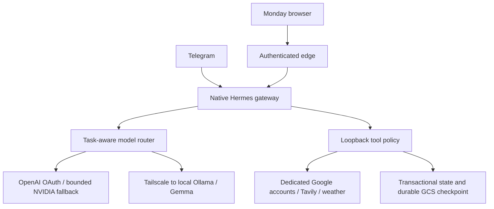
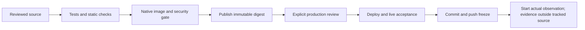

# Monday — Product and Interface Design

I use Monday to manage a fictional student's schedule, review test email, research topics and prepare drafts. My interface prioritizes useful content and clear decisions over operational noise.

## My selected experience

- **Telegram:** everyday requests, concise scheduled messages, unsolicited alerts and exact human email approval.
- **Browser:** authenticated chat and content-draft revision/copy/dismiss, using the supplied Hermes proxy contract.
- **Profile:** Alex Chen in Los Angeles, with synthetic-only accounts and preferences.
- **Fourth skill:** an original source-backed LinkedIn Content Brief, with no scraping or automatic publishing.

## Daily flows

| Flow | What I see | Safety and quality rule |
| --- | --- | --- |
| Morning briefing | Today's events, explicit free gaps, plain-language weather and top email summaries. | Retrieved data is used as data; missing sources are reported honestly. |
| Evening recap | Recorded activity, review decisions and tomorrow's early events. | No invented completion or unconfirmed send claims. |
| Alert | A short, contextual notification without a prompt. | Deduplicated delivery; uncertain outcomes are not blindly replayed. |
| Email draft | Exact recipient, subject and body in Telegram. | Owner approval, allowlist, payload binding and expiry before dispatch. |
| Content brief | Original draft, sources and review controls. | Claim/source validation is not a factual-truth guarantee; publishing remains manual. |

## Browser appearance and behavior

My Daylight visual theme uses soft raised panels and recessed inputs with readable contrast. The layout includes a compact connection area, conversation, message composer and content drafts.

- Keyboard-accessible controls, clear focus and mobile layout without horizontal page overflow.
- Complete-response loading state; the interface does not pretend to stream tokens.
- Failed requests preserve the unsent message and restore the composer.
- Sign-out clears the key and visible content; late responses cannot repopulate the session.
- External/model text is rendered as text rather than executable markup.
- Browser send requests use drafts and the Telegram approval path; no unusable web approval prompt.

## Telegram presentation

Scheduled content uses short bold headings, blank lines and Unicode bullets through native MarkdownV2 formatting. Cron response wrapping is disabled, removing job IDs and management footers. Deterministic alerts use escaped HTML. My meeting alerts show the title, date, start/end times, timezone and UTC offset so timing stays clear across midnight and daylight-saving changes. My morning Inbox section includes sender, subject and a short summary grounded in the supplied email preview, with actions/deadlines only when present. Missing previews are labeled rather than inferred.

Calendar availability is calculated within the stated fictional 09:00–17:00 workday. Overlaps and all-day events are handled; incomplete data is shown as unavailable. Email selection favors unread/starred messages and excludes ordinary promotion/social categories. A clean test profile, not filtering alone, enforces the assignment's synthetic-data restriction.

## System and delivery flow

## Design verification

My browser and Telegram checks are recorded in [IMPLEMENTATION_STATUS.md](IMPLEMENTATION_STATUS.md). Model quality, tool behavior and actual scheduled delivery are assessed separately from layout. [ARCHITECTURE.md](ARCHITECTURE.md) explains component tradeoffs and all 94 requirement mappings; [FINAL_REVIEW.md](FINAL_REVIEW.md) defines the release procedure.

## My daily reading and weather recovery

My morning briefing adds **Today’s AI read**: one relevant LinkedIn AI/Agentic AI post link, a short search-preview summary and a reason to read it. I label preview-only evidence, keep original draft creation, and avoid recent repeated recommendations. A missing result stays explicit.

Weather uses Open-Meteo first and NWS when the primary cannot respond. Each fallback forecast keeps its named local period and high/low meaning; I never turn forecast temperatures into claimed observations.

## Local connection recovery

I allow up to two retries when the private connection cannot be established, with short backoff inside the existing request deadline. I do not replay read/write failures or uncertain completed requests. The provider selection, 65,536-token local context and private-local boundary remain unchanged. My explicitly approved November 19 maintenance exception retains the original observation logs and records any deployment interruption. [Architecture](ARCHITECTURE.md#a5-hybrid-routing-privacy-and-model-failure)
